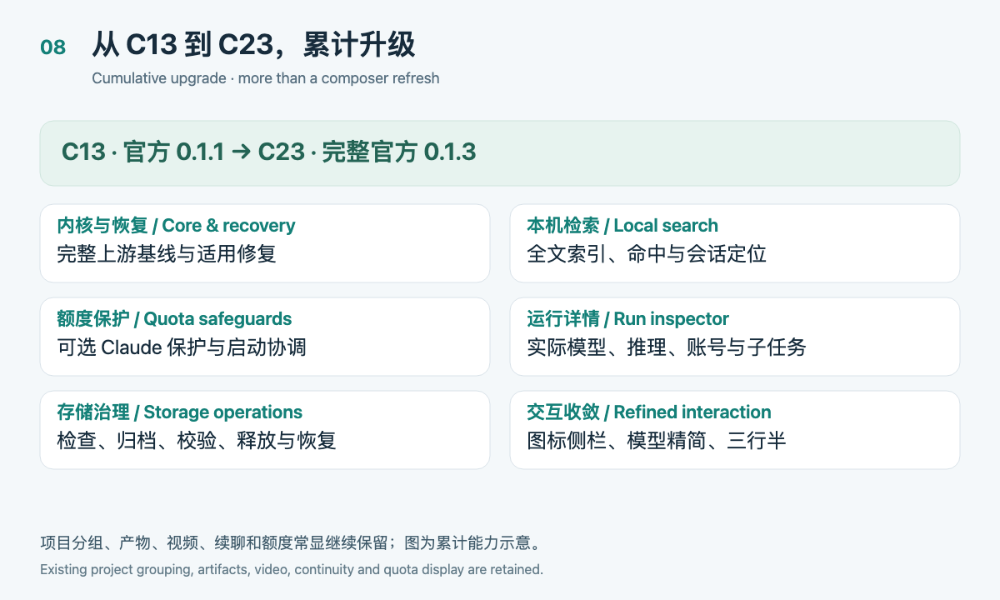
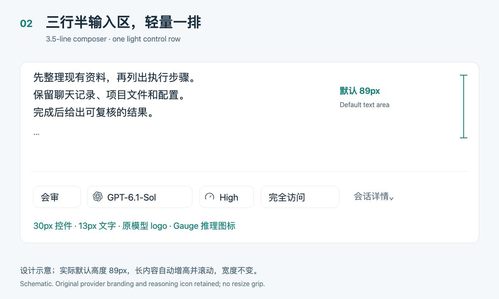
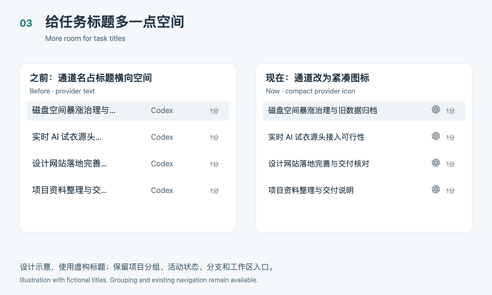
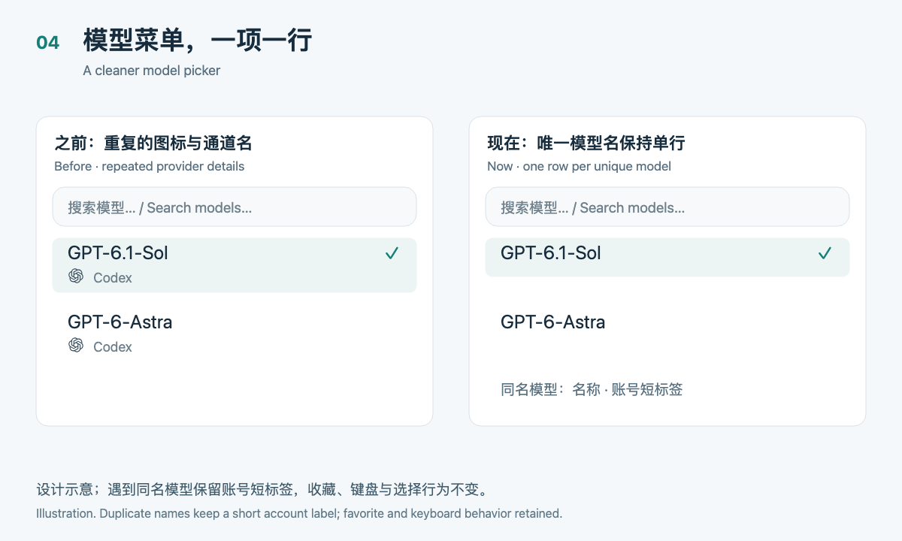
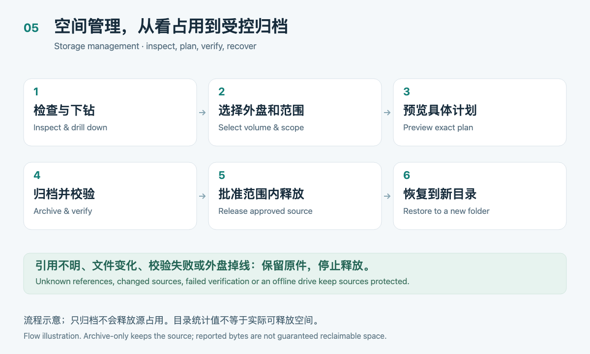
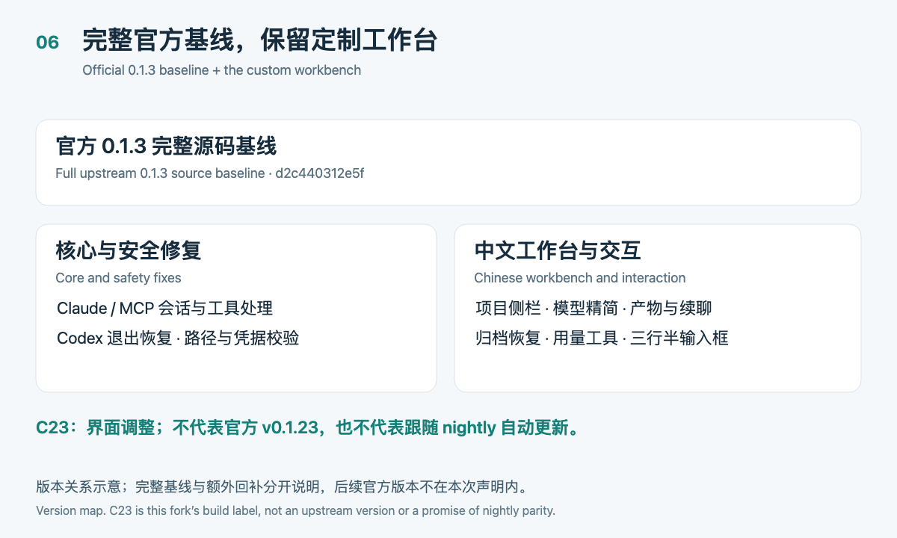
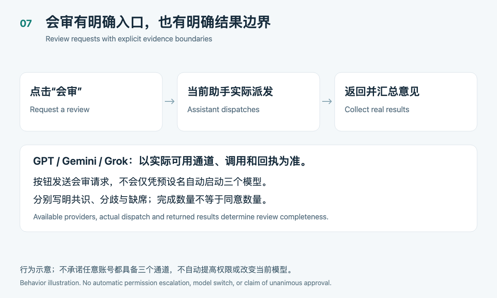

# T3 Code · Xiaoxin Edition C23

[简体中文](README.md) · [Download C23](https://github.com/labixiaoxins/t3code-artifact-wall/releases/tag/xiaoxin-c23-20261028) · [Install and recovery](docs/community/README.en.md) · [Changelog](docs/community/CHANGELOG.en.md) · [Upstream](https://github.com/pingdotgg/t3code)

**Upgrading from the previous public release:** [Full C13 → C23 comparison](docs/community/C13-TO-C23.en.md), covering search, quota safeguards, run visibility and core changes, with new and retained features distinguished.

A community edition based on the **full official T3 Code 0.1.3 source baseline**, retaining a project-first Chinese workbench and improving long-running work, artifact browsing, storage operations, and everyday composition and model selection.

**C23 is this fork’s build label, not an official version number.** The downloadable application is for Apple silicon Macs. Upstream MIT notices are retained. It is ad-hoc signed and not Apple-notarized. Accounts, subscriptions, chats, projects, private settings and API keys are not included.

*The first image is an actual capture from an isolated synthetic-data environment. The diagrams below explain behavior using fictional content; they are not runtime acceptance screenshots.*

## More than a UI refresh

The public C13 used official **0.1.1**; this build integrates complete **0.1.3**. Local full-text search, optional Claude quota safeguards, the run inspector and safeguarded storage operations were added between them. Project grouping, artifacts, continuity and quota display are retained capabilities.

See the [full C13 → C23 comparison](docs/community/C13-TO-C23.en.md). Quota safeguards require provider configuration and are not universally enabled. Local search is not macOS-wide Spotlight. The run inspector distinguishes actually reported execution from requested settings and does not invent missing results.

## Important changes since C13

| Change | Result | Boundary |
| --- | --- | --- |
| Full official 0.1.3 baseline | Integrates the complete upstream version while retaining applicable verified backports | No claim of including every later nightly change |
| Cleaner model picker | Unique display names use one row without repeated provider icons or labels | Duplicate names keep a short account label |
| Title-first sidebar | Compact provider icons replace Codex / Claude text badges | Project groups, activity, branches and workspace actions remain |
| 3.5-line input + A1 footer | 89px default text area, automatic growth and scrolling, consistent light controls | Original brand logos and Gauge reasoning icon retained; width unchanged |
| Actionable storage page | Inspect, drill down, plan, archive, verify, release under safeguards, and restore | Unknown references remain protected; no promised reclaimable amount |
| Explicit review request | Ask the current assistant for actual delegation and synthesis; model bookmarks move into the picker | The button does not automatically run three models by preset name |
| Existing workbench retained | Chinese/pinyin project search, artifacts, document/video viewing, conversation continuity and usage tools | Models, accounts and quotas depend on your own providers |

## 1. A composer that leaves room to work

The default text area is 89px high, with 30px controls and 13px text. Longer input expands to 208px or the viewport limit, then scrolls internally. There is no resize grip or remembered manual height.

Provider logos retain their original shapes and colors. Reasoning keeps the Gauge icon. Review, model, reasoning and access-mode controls share light spacing and typography without changing option values or permission semantics.

## 2. More room for sidebar titles

Compact provider icons replace text labels, giving conversation titles more horizontal room. Inactive titles are less heavy while selection, project grouping and workspace navigation remain. Actual visible title length still depends on window width, fonts and other status indicators.

Existing Appearance settings still control global interface font, font size, theme and contrast. **This release does not add separate sidebar-only font, size or text-color controls.**

## 3. Less repetition in model selection

Provider categories already appear at the side of the picker. Unique model names therefore do not repeat a second provider icon/name row. Favorites, search, keyboard actions and selection remain. When display names collide, an inline short account label distinguishes them.

## 4. Storage operations with a recovery path

Open Usage → Disk space to inspect the selected environment, measurement time and directory sizes. Drill down, choose a mounted destination volume, and preview an exact plan. Supported operations include archive-only, archive-and-release for reviewed eligible sources, local indexes, operation records, and restoration into a new directory.

- Archive-only retains the source and therefore does not free its space.
- Releasing a source requires content, metadata, volume identity, source-state and recovery-reference checks. Unknown, changed, busy or unverifiable objects remain protected.
- Storage operations share a maintenance lock with existing cleanup. Read-only inspection does not invoke a destructive cleanup sweep.
- Budget checks guard selected build, packaging and update entry points. They are not system-wide write interception or automatic file deletion.
- APFS clones and shared blocks affect actual reclaimed space. Directory size and archive size are not proof of released physical capacity.

## 5. A clear upstream baseline and honest review semantics

Official commit `d2c440312e5f39d59827ed466838a623516454d6` is the complete 0.1.3 baseline. Applicable Claude tool/MCP session fixes, Codex exit recovery, path containment and GitHub credential validation remain. Upstream document/PDF previews, indexed search, database maintenance and recovery implementations are included through the full baseline.

The Review action sends an explicit request to the current assistant. Actual delegation depends on available providers. Neither the button nor a model bookmark proves that three models ran. Consensus, disagreement, missing reviewers and failures must be reported from actual returned results.

## Download and upgrade

Download `T3-Code-Xiaoxin-C23-macOS-arm64.zip` from the [C23 release](https://github.com/labixiaoxins/t3code-artifact-wall/releases/tag/xiaoxin-c23-20261028). Checksums are provided there. C13 and C11 remain available.

For an existing installation, finish tasks, quit normally, and back up the matching application, T3 home and persistent desktop state before replacing the app. Run only one copy. This edition uses the existing T3 application identity and data locations. **Do not let an old binary blindly write a newer database. Restoring an older data snapshot can lose newer work; never overwrite your only current copy.** See [installation and recovery](docs/community/README.en.md).

## Validation and limitations

- The final C23 candidate was installed on the maintainer’s Mac. Application hash, runtime version 0.1.3 and renderer entry match. Existing messages, thread bindings, projects, sidebar state, configuration and login-key files passed preservation checks.
- Web typecheck, targeted lint and build passed for the composer changes; 9 browser tests across 2 files and 13 installer safety checks passed. Synthetic UI checks covered 1280, 900 and 390px widths and long input.
- `check:changed` passed format, lint, affected-package typechecks and adjacent tests. Both global **knip stages still report unused-code/dependency issues**. This is not an all-green repository claim.
- Storage archive/restore round trips were checked earlier in isolated fixtures. Diagrams do not substitute for those tests, and no production data was deleted to manufacture space savings for this release.
- Distribution checks additionally cover signature, ZIP integrity, file content and startup with a clean data directory; see the release manifest. Recipient login, paid model calls, every provider, remote and mobile behavior have not been comprehensively accepted.

[Offline showcase](assets/community/c23/showcase.html) · [Chinese documentation](README.md) · [Upstream README](README.upstream.md)

Code and documentation were assisted by Codex / GPT-6.1-Sol in T3 Code. Product choices and real-use feedback come from Xiaoxin. Independent model reviews are not a substitute for user acceptance.

The publication branch retains this fork’s existing GitHub Actions workflows; CI/automatic-release configuration is unchanged. Application implementation remains the C23 source described above.
