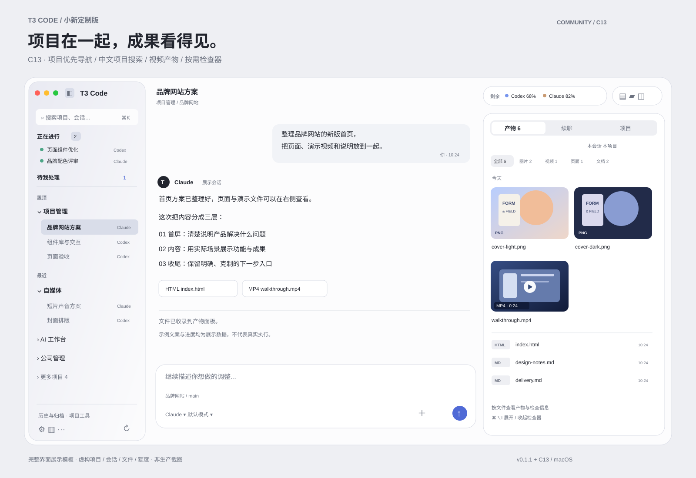
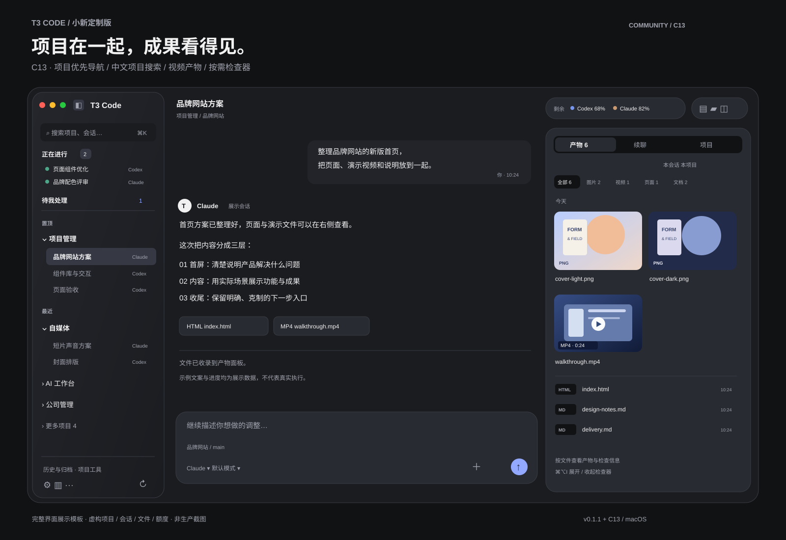

# T3 Code · 小新定制版

把多模型会话、项目导航与制作成果放进一个更顺手的工作台。基于 [T3 Code](https://github.com/pingdotgg/t3code) **官方 v0.1.1**，当前推荐 **C13 · 2026-10-26 分享版**，对应本机 2026-10-25 安装的 C13 r5。

**[下载 macOS Apple 芯片版](https://github.com/labixiaoxins/t3code-artifact-wall/releases/latest)** · [安装与使用](docs/community/README.md) · [改版特点与官方基线对照](docs/community/FEATURES.md) · [更新记录](docs/community/CHANGELOG.md)

*完整界面展示模板：项目、会话、产物、进度与额度均为虚构示例，非生产截图。布局依据 C13 实现整理。*

## 这次改版，解决哪些日常麻烦？

- **按项目找工作。** 默认把同一项目分类下不同模型的会话放在一起，模型保留为小标签；支持置顶、最近、更多项目，也能切回按模型分组。
- **中文项目更好找。** 按 ⌘K，先查项目，再查会话与消息；支持项目中文名、拼音全拼和首字母。例如展示项目“批量设计工具”可用 `plsj` 查找。
- **产物直接看。** 图片缩略图、HTML 页面、文档与视频分开筛选；新增 MP4 / MOV / M4V / WebM 视频收录、时长与内联播放。实际可播放格式取决于编码和系统支持。
- **右边按需展开。** “产物 / 续聊 / 项目”收进检查器，⌘⌥I 开关，记住上次标签，给主会话留出空间。
- **界面更统一。** 浅深色玻璃质感侧栏、浮动面板、胶囊工具栏；修正字标对齐，缩短运行路径，补齐中文标题。用量页隐藏重复额度胶囊。
- **保留此前的工作流。** 跨模型“正在进行”、待我处理、成果检查信息、续聊只读回看、草稿恢复及可配置额度常显继续保留。
- **保留外部应用弹窗修复。** 防止后台或定时网页导航反复要求打开外部应用，并记住当前标签页中已取消的站点/协议提示。

这些优势主要针对**中文、多项目、多模型、图文与视频制作**。模型能力、订阅额度和官方远程/移动端能力来自上游与提供方，不是本分支新增。[详细说明与边界](docs/community/FEATURES.md)。

## 两套展示模板

[浅色 SVG](assets/community/c13/workbench-light.svg) · [深色 SVG](assets/community/c13/workbench-dark.svg) · [离线 HTML 模板](assets/community/c13/showcase.html)

SVG 可作为仓库展示图或继续编辑；下载 HTML 后用浏览器打开，可切换浅深色。模板不连接服务、不调用模型、不包含真实聊天和账号数据。

## 下载与使用

1. 在 [Releases](https://github.com/labixiaoxins/t3code-artifact-wall/releases/latest) 下载 `T3-Code-Xiaoxin-C13-macOS-arm64.zip`。仅提供 **Apple 芯片 Mac** 包，应用声明最低 macOS 13。
2. 解压并放入“应用程序”。已有 T3 用户先完全退出并备份应用和自己的数据，只运行一份。[升级步骤](docs/community/README.md#已有-t3-如何升级)。
3. 连接自己的模型账号，再添加自己的项目。下载包不含账号、订阅、API 密钥、聊天、项目或私人模型通道。

本包使用 **ad-hoc 社区临时签名，未获 Apple Developer ID 公证**。首次打开可能需在系统设置中确认“仍要打开”；不需要关闭系统整体安全检查。

## 版本与验证边界

- 本分支比较基线固定为官方 **v0.1.1 / `fe27e8e3dc12dcbb108e9a28fd9b8cb65f34ae92`**。截至 2026-10-26 核查，官方最新稳定版为 [v0.1.2](https://github.com/pingdotgg/t3code/releases/tag/v0.1.2)；C13 尚未合并其全部修复，不应当作官方最新版替代品。
- 本机 C13 r5 已安装；针对性类型检查、单元/浏览器/服务端测试及构建有记录。lint 仍有既有错误，不宣称全仓检查通过。发布另检查源码一致、分享包完整性和隔离空目录启动。[完整验证范围](docs/community/README.md#验证范围)。
- 真机全屏、原生右键置顶、接收者首次登录与各模型真实调用仍需使用者确认；模板不作为功能验收证据。
- 未提供 Windows、Intel Mac、Linux 包；T3 Notch/刘海为独立伴随应用，**未包含在本次下载包**。私人网关、个人技能库、设备服务同样不包含。
- 额度以提供方实际支持的数据为准。无数据或过期显示不可读，不能视为 0 或 100%；部分提供方没有通用余额接口。

这是独立社区分支，不代表 T3 Tools。保留 [MIT License](LICENSE)、第三方许可和[官方原始 README](README.upstream.md)。[源码运行与安装说明](docs/community/README.md#从源码运行)。
