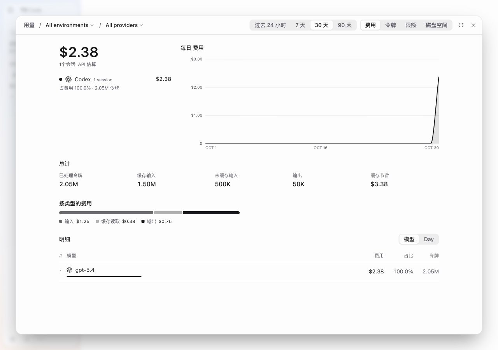
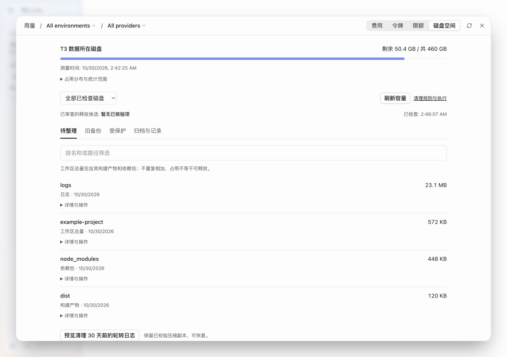
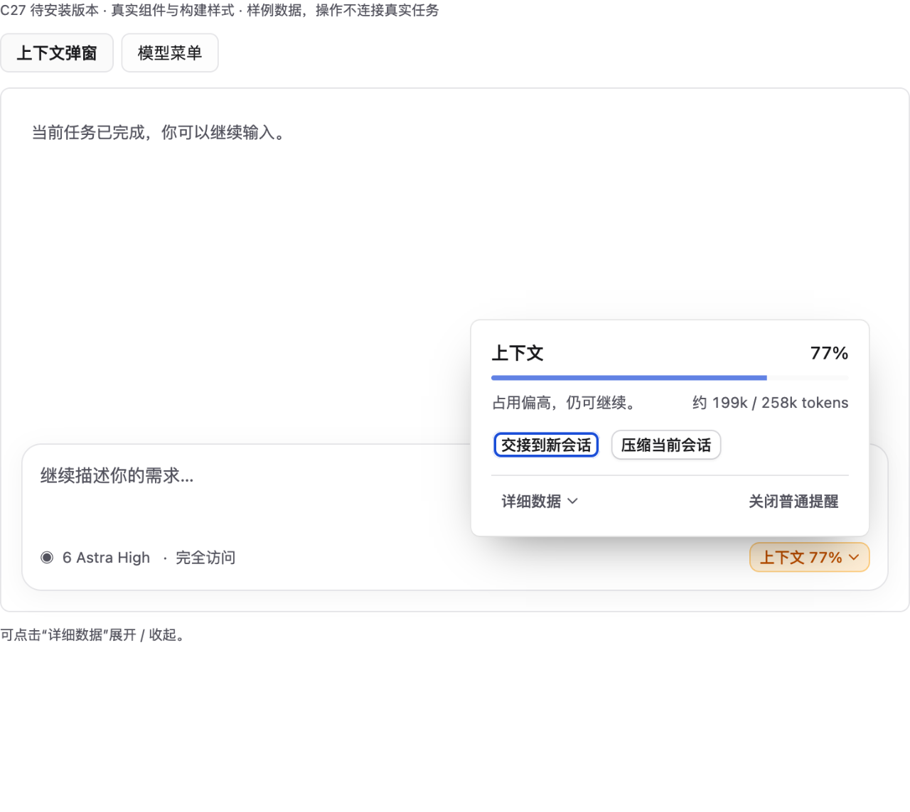
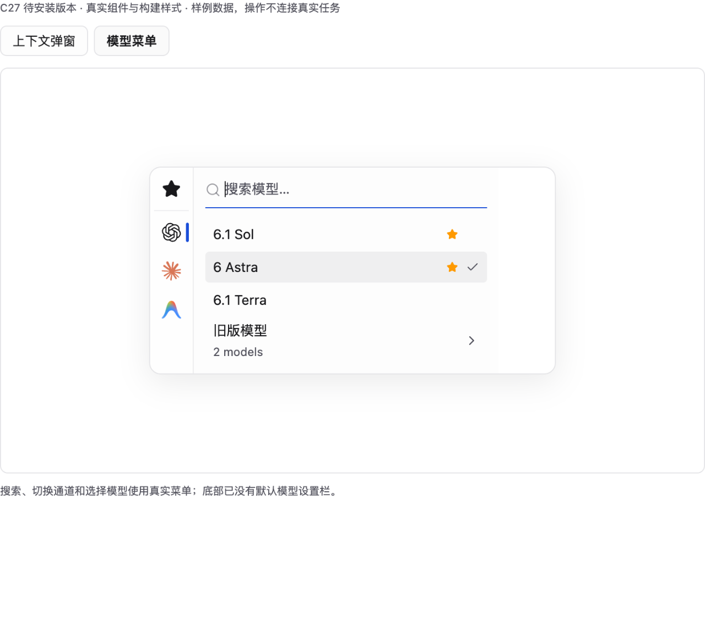
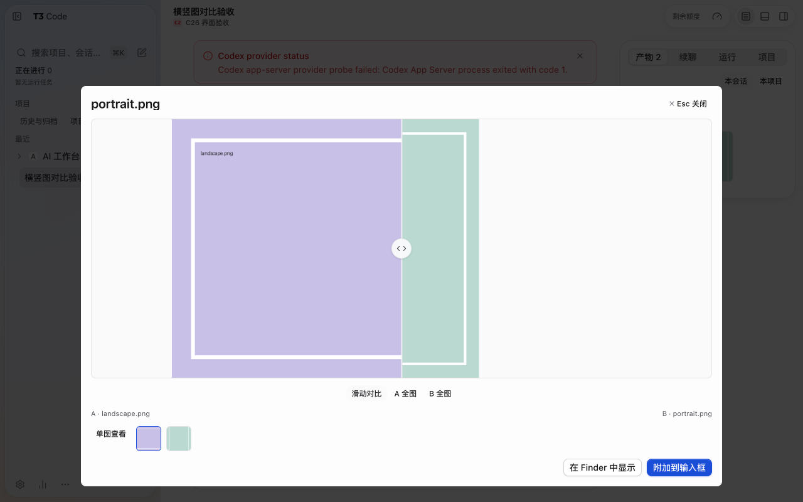

# Xiaoxin T3 Code · 小新社区版 C28

[English](README.en.md) · [下载 C28 预发布版](https://github.com/labixiaoxins/xiaoxin-t3code/releases/tag/xiaoxin-c28-20261030) · [完整更新与使用说明](docs/community/C28.md) · [上游 T3 Code](https://github.com/pingdotgg/t3code)

基于 **官方 T3 Code 0.1.5** 的社区定制版。保留 T3 自带模型订阅接入的工作方式，重点改进日常输入、长会话信息、图片成果查看和本地空间整理。`C28` 是本项目的社区构建编号，不是官方版本号。

本次是 **C25 → C28 的累计预发布更新**，包含中间版本的界面与内核升级。维护者本机已完成 C28 程序替换，运行程序、前端入口、已有消息、项目、侧栏、配置与登录关键文件的安装后核验通过；**空闲 CPU 验收仍待完成**。详细验证范围见 [C28 发布记录](docs/community/C28.md#验证范围与已知限制)。

## 这次更新解决什么

| 日常问题 | C28 的变化 |
| --- | --- |
| 输入区偏高，底栏入口太多 | 采用三行默认输入区；移除内置会审入口，按需要自行请求评审 |
| 模型菜单底部的默认设置占空间 | 删除“新任务默认模型”设置及底部附加入口，保留模型搜索、收藏和选择 |
| 上下文弹窗信息太长 | 默认只呈现关键用量和续聊操作，运行细节按需展开 |
| “费用”和“令牌”看起来一样 | 费用模式显示金额与费用占比；令牌模式显示 token 数量与占比 |
| 磁盘页只展示占用 | 按磁盘、类别和保护状态查找项目，再预览归档、释放或恢复操作 |
| 横图与竖图叠加时互相干扰 | 改进对比区域裁切，提供 A / B 单图查看；修改意见功能默认关闭，可按需开启 |
| 网页预览放大再缩小后位置漂移 | 修正浮动预览窗口的锚点与尺寸恢复逻辑 |

自定义侧栏外观继续保留，也可选择官方侧栏布局。此版没有自动开启多模型会审，不附带模型订阅、账号、私人配置或 API 密钥。

## 费用与令牌，各自说清楚

打开“用量”，切换“费用 / 令牌”。费用页的总额、提供方金额、占比和图表现在使用一致的费用口径；令牌页则使用 token 口径。修复覆盖中文和英文界面。

*C28 打包程序实际截图，使用隔离测试数据。金额是 API 用量估算，不是订阅账单、已扣款记录或充值余额。未定价和缺失数据不能视为零费用。*

## 磁盘空间，从查看到有范围的整理

“用量 → 磁盘空间”提供磁盘筛选、按需容量测量、名称或路径搜索，以及“待整理 / 旧备份 / 受保护 / 归档与记录”分类。详情中可以检查来源、路径和可用操作，再确认具体计划。

*C28 打包程序实际截图，目录与文件内容使用隔离测试数据。截图中的容量不是可释放空间承诺。*

- 区分工作区总量、依赖包、构建产物、日志和保护数据；工作区包含其子目录，统计不会将重叠部分重复算成可释放容量。
- 支持既有外盘归档、符合审查条件的释放、操作记录和恢复到新目录。只归档会保留源文件。
- 增加超过 30 天的轮转日志清理预览：先生成并校验压缩副本、登记恢复索引，再处理已确认且未变化的文件。当前日志继续保留。
- 选中外盘时，不显示属于 T3 数据盘的日志清理按钮，避免误解操作范围。

这是有范围的 T3 存储管理，**不是全盘清理器**。不会把所有 AI 软件文件、缓存、旧备份或日期较早的目录自动判断为垃圾。未知引用、未审查项目和有效回滚资料继续受保护。归档与清理执行器目前支持 macOS。

## 长会话与模型选择更紧凑

上下文面板先显示当前状态和主要操作，模型运行、速度与上报细节在需要时展开。模型菜单不再带“新任务默认模型”底栏，常用搜索与选择保留。

*以上两图由本版对应源码组件渲染，使用模拟数据；外围输入框是预览框架，不是完整应用截图，也不代表模型已经执行。*

## 图片对比更适合横竖混排

图片修改意见入口默认关闭，需要时再开启。对比时改进两侧裁切，单独查看 A 或 B 时隐藏另一张图，避免横图从竖图背后露出大片区域。原图尺寸和文件不因查看模式而改变。

*该图为 C26 打包程序的实际混合比例测试截图，功能随本次累计更新保留；使用测试图片，非本次重新执行的真实模型返工。*

## 下载、升级与恢复

从 [C28 Release](https://github.com/labixiaoxins/xiaoxin-t3code/releases/tag/xiaoxin-c28-20261030) 下载 `Xiaoxin-T3-Code-C28-macOS-arm64.zip`，并核对同页 `SHA256SUMS.txt`。当前下载包面向 Apple 芯片 Mac，采用社区临时签名，未经 Apple 公证；最低系统要求以发行清单为准。

已有 T3 用户应先完成任务并正常退出，再保存同一时点的应用和完整数据备份，然后替换应用。此版沿用 T3 的应用身份与数据位置，**不要同时运行官方版与社区版**。程序回退与数据库回退是两件事，切勿用旧数据库覆盖唯一的当前资料。具体步骤见 [C28 安装与恢复说明](docs/community/C28.md#下载升级与恢复)。

## 验证到哪一步

- C28 的 33 项功能测试、48 项安装器测试通过；web、server、contracts 类型检查、目标 lint 和构建通过。
- 使用隔离数据验证了费用切换、磁盘分类、分盘操作范围、日志归档清理和恢复；1280px 浅色及 390px 深色页面完成检查。
- 本机已安装 C28，程序与数据保护核验通过，空闲 CPU 验收仍待完成。
- 完整 `check:changed` 未通过，存在 lint、knip、预算测试和 React Compiler 检查失败，聚合类型检查另受缺少 Astro 阻断。具体结果、公开包注释标准化与未覆盖场景见 [详细发布记录](docs/community/C28.md#验证范围与已知限制)。

不将局部测试描述为所有平台、模型提供方、远程连接和移动端均已验收，也不以示意图代替实际功能测试。上游 MIT 许可及署名保留。

[C25 历史记录](docs/community/C25.md) · [C13 → C23 历史演进](docs/community/C13-TO-C23.md) · [上游说明](README.upstream.md)
