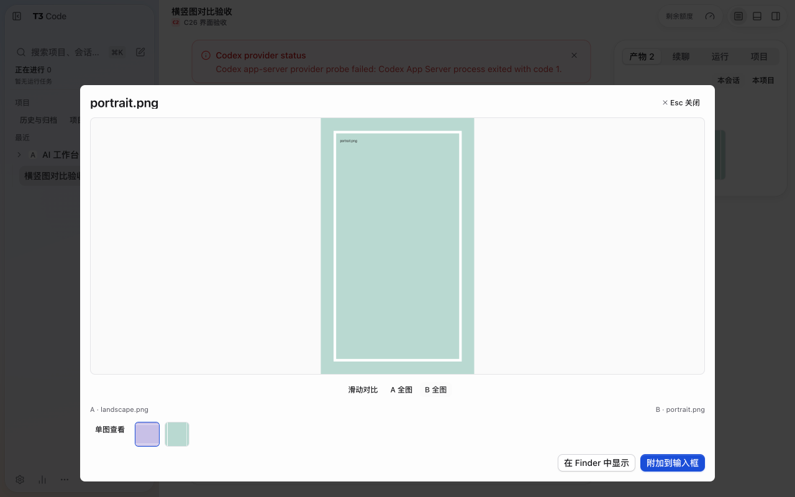
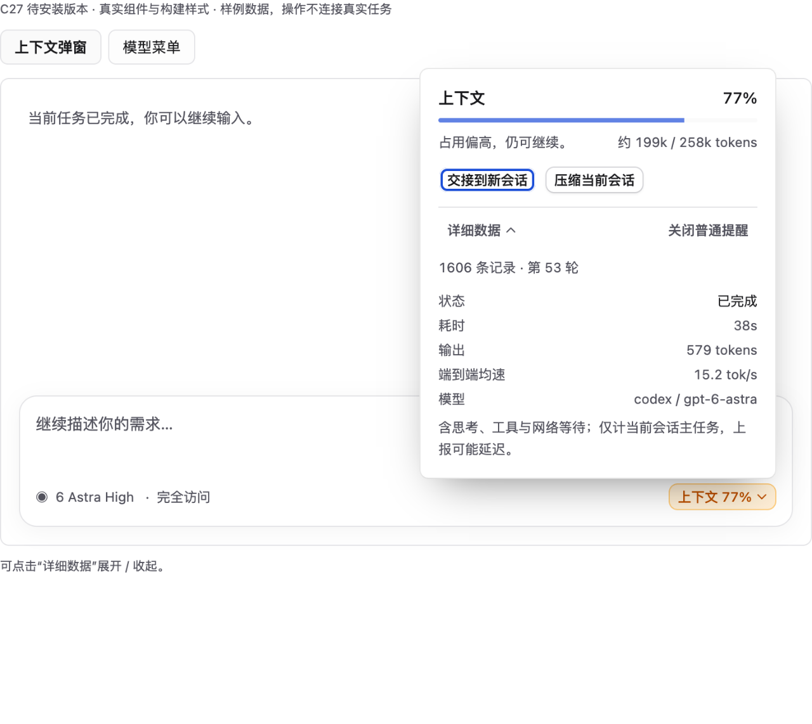
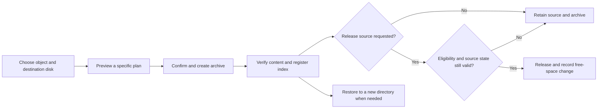
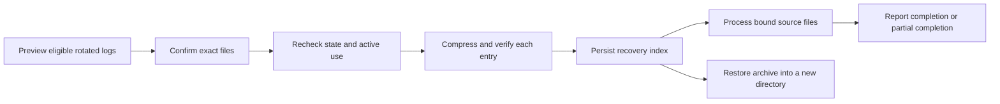

# C28 release and usage guide

[简体中文](C28.md) · [Project home](../../README.en.md) · [Download prerelease](https://github.com/labixiaoxins/xiaoxin-t3code/releases/tag/xiaoxin-c28-20261030)

Release date: October 30, 2026. Community build C28, official source baseline 0.1.5. This guide covers cumulative changes since the previous public C25 release: C26's baseline upgrade, C27's context/model-picker cleanup, and C28's usage and storage fixes.

This is a **prerelease**. C28 is installed on the maintainer's Mac, with the running application, renderer entry and data-preservation checks passed. Idle CPU acceptance remains pending. Installation and acceptance across all scenarios are distinct claims.

## 1. Composition, sidebar and web previews

### Three-line composer and reviews on demand

The default text area is reduced to three lines using the upstream composer layout. Longer content remains editable and scrollable. The built-in council entry is removed; when a review is useful, specify the review objective and participants in the task. Removing the entry does not automatically enable or invoke models.

The customized project sidebar and existing appearance preferences are retained, with the upstream sidebar layout also available. Existing font and light/dark appearance preferences remain usable; the release does not reset everyone to a different color scheme.

### Floating preview positioning

The floating web preview's anchor and size-restoration logic are corrected to address drift after enlarging and then shrinking the window. Focused layout tests passed. This does not establish coverage of every monitor arrangement, display scale or native macOS window interaction.

## 2. Image viewing and comparison

Image revision feedback is off by default and can be enabled when needed, reducing persistent controls while browsing results. Enabling it still works through feedback and revision drafts; clicking does not mean an image has already been modified.

Comparison improves the divider controls and clipping on both sides. For mixed portrait/landscape images, A / B whole-image viewing hides the other image, preventing it from showing around empty areas. Viewing modes do not crop or overwrite source files.

*Source: actual C26 packaged application test using landscape and portrait fixtures. The behavior is retained in C28. This image does not indicate a new real-model generation or revision run.*

Existing revision matching continues to use stable provenance. A model's version check is not a filesystem lock; a UI prompt does not establish that concurrent writes have been locked out.

## 3. Model picker and context information

### Model picker

The new-task-default footer and its extra entry points are removed, reducing information unrelated to everyday model selection. Provider categories, model search, favorites, keyboard selection and current-model selection remain. This does not remove provider integrations or automatically change provider accounts.

### Context panel

The default view emphasizes current context usage and the main actions for continuing work. Runtime, speed and reporting details move into an expandable area. Handoff and compaction actions remain subject to actual state; they can be unavailable while a model is running or other requirements are unmet.

*The three images in this section render the corresponding source components using fictional data. The surrounding composer is a preview frame, not a full application capture. These previews demonstrate component appearance and do not replace acceptance of the full sending workflow.*

Reported context usage may be delayed. End-to-end throughput includes reasoning, tools and waiting; it is not the model's pure text-generation speed.

## 4. Correct Cost and Tokens semantics

Some Cost presentation logic previously depended on translated UI text, allowing totals or provider rows to show tokens even when Cost was selected. The fix separates internal metric identifiers from translation labels:

| Mode | Primary value | Provider share | Chart and breakdown |
| --- | --- | --- | --- |
| Cost | Currency | Cost share | Currency-based |
| Tokens | Token count | Token share | Token-based |

Currency and tokens can still appear together as supporting information, but the Cost headline no longer substitutes the token total for an amount. Regression tests cover both Chinese and English.

*Packaged C28 application with isolated test data. The example values demonstrate metric semantics and are not the maintainer's or another person's real bill.*

Cost is an **API estimate** based on available model prices and reported usage. It is not a subscription charge, remaining monthly quota or provider settlement statement. Unpriced models, incomplete reporting and differences in cache pricing can affect estimates; unpriced does not mean free.

## 5. Storage: locate items before choosing an action

Open Usage → Disk space, choose an environment and disk, then measure sizes when needed. Inspection is bounded in scope and time rather than recursively scanning every disk on each visit. Results include a measurement time; size results may be cached briefly and can be refreshed.

*Packaged C28 application with isolated test directories. Directory size, compressed archive size and actual reclaimed disk space are different metrics.*

### Categories and scope

| Category | Meaning |
| --- | --- |
| Items to organize | Identified workspace totals, dependencies, build outputs and logs for further inspection |
| Older backups | Recognized backup or rollback-related items; age does not make them safe to delete |
| Protected | Chats, attachments, histories and other retained data or objects that do not meet release requirements |
| Archives and history | Registered archives, operation status and restore entry points |

Name/path search narrows the list, and details expose paths and available actions. A workspace total includes its dependencies and build directories, so parent and child sizes must not be added twice. Reviewed release candidates include only eligible reviewed items, not every occupied byte.

Selecting an external disk hides the log-cleanup action that belongs to the T3 data disk. Archive destination and source are checked separately, so destination free space is not mistaken for space already reclaimed on the source disk.

### Archive, release and restore

The following diagram explains behavior; it is not an execution receipt:

- **Archive-only** retains the source and therefore does not reclaim its occupied space.
- **Archive-and-release** is available only for sources meeting the existing review and protection requirements. Changed files, active use, mismatched volume identity or failed verification preserve the source.
- **Restore** writes to a new directory, avoiding overwrites of current work. Reading an archive on an offline external disk requires reconnecting the available original destination volume.
- APFS clones, shared blocks and other processes' writes affect physical free space; deleting a logical number of bytes does not promise the same physical gain.

### Rotated logs older than 30 days

A new action previews rotated logs older than 30 days. The exact file list and scope are shown before confirmation. Eligible files must be owned by the current user, regular singly linked files, and match the filename and age rules. Current logs, recent logs, symbolic links and unrelated files are excluded.

A plan handles at most 200 files and 512 MiB. It binds file state and expires after a limited period. Files are checked again before execution; changed or in-use files are not cleaned.

The compressed copy stays on the same machine, so actual reclaimed space is usually smaller than the original log total. Cleanup and restoration were exercised end to end through the UI and worker using isolated test files. No production chats or user materials were deleted to manufacture a release demonstration.

### Support boundaries

This is not whole-disk search or a general system cleaner, and it does not integrate Mole to sweep the entire system. It currently recognizes T3-related locations and some common generated directories. Cache, build-output and dependency names are classification hints, not deletion permission. Unknown sources and unreviewed backups remain protected.

The archive and cleanup worker is currently implemented for macOS. Unsupported environments report unavailability without starting writes. This release does not add corresponding native mobile management screens.

## Download, upgrade and recovery

1. Download `Xiaoxin-T3-Code-C28-macOS-arm64.zip` and the checksum file from the [C28 release](https://github.com/labixiaoxins/xiaoxin-t3code/releases/tag/xiaoxin-c28-20261030). The package targets Apple silicon Macs; the release manifest records the minimum macOS version.
2. Verify the asset's SHA256 against `SHA256SUMS.txt`. If all listed assets are downloaded, run `shasum -a 256 -c SHA256SUMS.txt`; otherwise check only the corresponding entries.
3. Finish existing tasks and quit T3 normally. Back up the matching application, complete T3 home and persistent desktop state at the same point in time. If SQLite WAL/SHM files remain, preserve them with their database as a single group rather than discarding them separately.
4. Extract, replace and launch the application, then check projects, chats, login, providers and keybindings. This edition uses T3's existing identity and data locations; it is not an automatically isolated second installation. Run only one copy.
5. The community package is ad-hoc signed and not Apple-notarized. If first launch is blocked, verify the repository, checksum and source, then use macOS's allowed-open flow in Privacy & Security. Do not disable global system protection.

An upgrade may include upstream database migrations or additional keybindings. For rollback, preserve the post-upgrade state first, then restore a matching older application and consistent data snapshot into a separate new directory for inspection. **Never overwrite your only current data with an older database.** Old snapshots do not contain later chats or files, and application rollback does not automatically merge those differences.

The download includes no maintainer account, chats, subscription, private settings or keys. It also includes no force-quit, database-wipe or personal-data overwrite installation script.

To run from source, use branch `community/xiaoxin-c28` or tag `xiaoxin-c28-20261030`, install the Node.js version and Vite+ required by the root package.json, then run `vp i` and `vp run dev --no-seed`. Keep development state separate from production; do not point a development server at the live user database.

## Validation and known limitations

| Area | Result or boundary |
| --- | --- |
| C28 focused feature tests | 33 passed, covering metric semantics, storage classification, changed-log refusal, archive integrity, cleanup/restore and related context behavior |
| Installer tests | 48 passed, including database/WAL safeguards and serial-install state checks; this is not a promise of a bundled automatic updater |
| Types, targeted lint and builds | Web, server and contracts typechecks, targeted lint and server/web builds passed; the C26 baseline upgrade has separate desktop typecheck evidence |
| Actual UI | Packaged application with isolated data exercised Cost/Tokens, per-volume classification, cleanup confirmation and restoration; inspected at 1280px light and 390px dark |
| Local post-install readback | C28 application and renderer entry match; existing messages, thread bindings, projects, sidebar state, configuration and login-key preservation checks passed |
| Idle CPU acceptance | Pending; no claim of a fully accepted performance result |
| Not comprehensively covered | Real calls across every provider, recipient first login, every remote/tunnel mode, Windows/Linux cleanup workers and native mobile clients |

The full `check:changed HEAD` run is **not green**. Its results are listed explicitly rather than labeling every failure as pre-existing:

- Formatting, unused-patch and GraphQL checks passed.
- Lint failed on rules including effect rationale, test rendering and copy; both knip phases failed.
- Aggregate typechecking across 36 packages was blocked by a missing Astro executable. This scope differs from the core package checks that passed.
- Aggregate tests covered 8 files: 99 tests passed and 1 failed because `AgentContextBudget` values did not match the budget file.
- React Compiler checks passed for 8 of 10 components. `ContextHandoffNotice` and `StorageManagementPanel` failed because `finally` makes the compiler skip optimization. Passing focused functional tests does not substitute for this optimization check.

The public download has an additional privacy adjustment: 777 build-origin line comments in four desktop JavaScript bundles were normalized to remove local build-volume paths. Business code and 96 native entries remain unchanged. Consequently, the public ASAR hash differs from the maintainer's installed package; they are not byte-identical distributions. The public package passed renewed signing, per-file ZIP verification, and HTTP version 0.1.5 / renderer-entry hash checks. Use the release manifest and SHA256 values supplied with the public download.

Images are labeled as C28 packaged captures, corresponding source-component previews, or retained C26 test captures. Test values are not real bills, a preview frame is not a full application acceptance test, and a historical image is not a new execution record.

Upstream MIT licensing and attribution are retained. Users configure their own provider terms, account permissions and quotas.

[C25 release record](C25.en.md) · [Earlier C13 → C23 evolution](C13-TO-C23.en.md) · [Upstream project](https://github.com/pingdotgg/t3code)

This publication retains the fork’s existing GitHub Actions workflow definitions. Application implementation includes upstream 0.1.5 and the custom changes; upstream deployment services are not represented as configured or operational.
