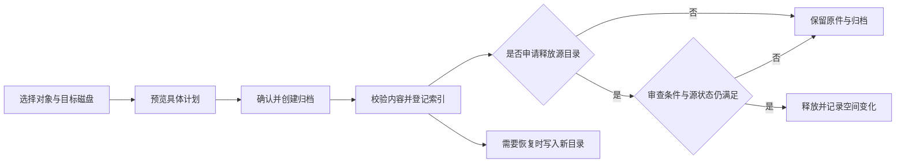
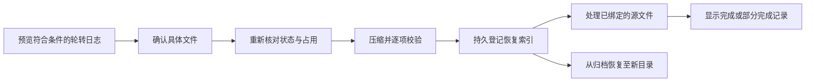

# C28 更新与使用说明

[English](C28.en.md) · [项目首页](../../README.md) · [下载预发布版](https://github.com/labixiaoxins/xiaoxin-t3code/releases/tag/xiaoxin-c28-20261030)

发布日期：2026-10-30。社区构建 C28，官方源码基线 0.1.5。本文覆盖上次公开 C25 之后的累计变化，包括 C26 的基础升级、C27 的上下文与模型菜单整理，以及 C28 的用量和磁盘管理修复。

本版作为 **预发布版** 提供。维护者本机已安装 C28，运行程序、前端入口和数据保留核验通过；空闲 CPU 验收仍待完成。不将“已安装”与“全部场景已验收”混为一谈。

## 1. 日常输入、侧栏与预览

### 三行输入区，评审按需调用

默认输入区从此前较高的样式缩为三行，采用官方输入区布局。长内容仍可继续输入和滚动。内置会审入口移除；需要多方评审时，直接在任务中说明评审目标和参与者。删除入口不会替使用者自动启用或运行模型。

自定义项目侧栏及原有外观偏好保留，也可使用官方侧栏布局。已有字体和浅色、深色外观设置继续可用，本次不会统一重设为另一套颜色。

### 浮动网页预览的定位修复

调整浮动预览窗口的尺寸恢复与锚点逻辑，处理放大后再缩小时角落位置偏移的问题。相关布局测试已通过；这不等于所有显示器排列、缩放比例和 macOS 原生窗口交互都经过逐项测试。

## 2. 图片查看与对比

图片修改意见功能改为默认关闭，需要使用时再开启，减少常驻操作对成果浏览的干扰。开启后，仍通过返工意见和草稿继续处理，不表示点击即完成图片修改。

对比查看改进了分隔控件和两侧裁切。横图与竖图混排时，可以使用 A / B 单图查看；该模式隐藏另一张图片，避免另一张图从空白区域露出。查看方式不会裁切或覆盖源文件。

*图示来源：C26 打包程序实际测试截图，使用横版与竖版测试图片；功能保留在 C28 中。该图不表示本次又执行了真实模型生图或返工。*

原有返工版本识别继续使用稳定来源信息。模型执行的文件版本核对不是文件系统锁；不要把界面提示当作并发写入已经被系统锁住的证明。

## 3. 模型菜单与上下文信息

### 模型菜单

移除底部“新任务默认模型”设置和附加入口，减少每次选模型时不需要的信息。提供方分类、模型搜索、收藏、快捷选择和当前模型选择继续可用。此次不是删除模型接入能力，也不是自动修改提供方账户。

### 上下文面板

默认状态下突出当前上下文用量和继续工作的操作。模型运行状态、速度、上报时点等细节收进展开区域，避免弹窗长期占据大块空间。交接与压缩入口按实际状态提供；模型正在执行或条件不满足时，相关操作仍会受限制。

*本节三图由对应源码组件实际渲染，内容为模拟数据；外围输入框是预览框架，不是完整应用截图。组件预览用于说明最终组件外观，不代替完整发送流程验收。*

上报的上下文用量可能延迟。端到端速度包括思考、工具和等待时间，不应解读为模型纯文本生成速度。

## 4. 修复费用与令牌的显示口径

此前费用页的部分显示逻辑受到界面翻译影响，导致选择“费用”后，总计或提供方区域仍显示 token 数量。本次将内部统计类型与翻译文案分离：

| 查看模式 | 主数字 | 提供方占比 | 图表与分项 |
| --- | --- | --- | --- |
| 费用 | 金额 | 费用占比 | 按费用显示 |
| 令牌 | token 数量 | token 占比 | 按 token 显示 |

金额和 token 可以作为辅助信息同时出现，但不会再把 token 总量放在费用页的主金额位置。中文与英文的回归测试均已覆盖。

*C28 打包程序、隔离测试数据。截图金额和用量只用于展示口径，不对应维护者或其他人的真实账单。*

费用是根据可用模型价格和已上报用量计算的 **API 估算**。它不代表订阅实际扣款、包月剩余额度或供应商结算单。模型未定价、上报不完整、缓存计费差异等都可能影响估算；未定价不等于免费。

## 5. 磁盘管理：先定位，再决定操作

进入“用量 → 磁盘空间”，先选择环境和磁盘，再按需测量容量。容量检查有范围和时间预算，避免每次打开页面都递归扫描整个磁盘。检查结果提供测量时间，大小缓存可能短时间复用，需要时可刷新。

*C28 打包程序截图，使用隔离测试目录。页面里的目录占用、压缩包大小与实际释放空间是不同指标。*

### 分类与范围

| 分类 | 如何理解 |
| --- | --- |
| 待整理 | 工作区总量、依赖包、构建产物、日志等已识别项目，供进一步检查 |
| 旧备份 | 已识别的备份或回滚相关项目；日期旧不等于可以删除 |
| 受保护 | 聊天、附件、历史和其他需要保留的数据或未满足释放条件的对象 |
| 归档与记录 | 已登记归档、执行状态和恢复入口 |

名称或路径搜索用于缩小范围，详情可查看路径和可用操作。工作区总量包含内部依赖与构建目录，不能把父目录和子目录重复相加。“已审查的释放候选”只计入满足现有审查条件的项目，不把所有占用都包装成可释放空间。

选择外盘时，属于 T3 数据盘的日志清理按钮会隐藏。归档目标与源目录分开核对，避免把“目标盘剩余空间”误读为“源盘已经释放的空间”。

### 归档、释放与恢复

以下是行为流程说明，不是执行结果截图：

- **只归档**保留原目录，因此不会释放其源占用。
- **归档并释放**只对满足现有审查与保护检查的对象开放。文件变化、占用、卷身份不匹配或校验失败时保留源数据。
- **恢复**写入新目录，避免覆盖当前文件。离线外盘中的归档需要重新接入可用的原目标卷后才能读取归档内容。
- APFS 克隆、共享块及其他进程写入会影响实际磁盘空闲量；不承诺“删除多少逻辑字节就释放多少物理空间”。

### 超过 30 天的轮转日志

新增“预览清理 30 天前的轮转日志”。确认前显示具体文件列表与范围，仅处理符合条件的历史轮转日志：由当前用户拥有、普通单链接文件，且名称与时间满足规则。当前日志、近期日志、符号链接和其他文件不在此操作范围。

单个计划最多处理 200 个文件、合计 512 MiB；计划会绑定文件状态并限制有效期。执行前再次检查，文件变化或正在使用时不继续清理。

压缩副本保留在本机，故实际释放量通常小于源日志总量。清理与恢复已在隔离测试文件上完成界面到执行器的往返检查；没有为发布截图而删除生产聊天或用户资料。

### 支持边界

这不是全盘搜索或通用系统清理器，也没有直接集成 Mole 扫描整个系统。现阶段识别 T3 相关范围和部分常见生成目录；缓存、构建产物、依赖包的名称只是分类依据，不自动授予删除权限。未知来源和未审查备份继续保护。

归档与清理执行器目前为 macOS 实现。其他环境显示不可用时不会开始写入。此次没有新增对应的原生移动端管理界面。

## 下载、升级与恢复

1. 从 [C28 Release](https://github.com/labixiaoxins/xiaoxin-t3code/releases/tag/xiaoxin-c28-20261030) 下载 `Xiaoxin-T3-Code-C28-macOS-arm64.zip` 和校验文件。包面向 Apple 芯片 Mac，最低 macOS 版本见发行清单。
2. 核对 `SHA256SUMS.txt` 中对应附件的 SHA256。完整下载全部附件时可运行 `shasum -a 256 -c SHA256SUMS.txt`；只下载部分附件时仅校验相应条目。
3. 等待现有任务结束，正常退出 T3。保存同一时点的应用与完整 T3 home、桌面持久状态备份；如 SQLite 仍有 WAL/SHM，它们应与数据库作为同一组保存，不要单独丢弃。
4. 解压并替换应用后启动，核对原项目、会话、登录、提供方配置与快捷键。此版沿用现有 T3 应用身份和数据位置，不是自动隔离的第二套软件；只运行一份。
5. 社区包为临时签名、未经 Apple 公证。首次启动被拦截时，确认仓库、校验值和来源，再使用 macOS“隐私与安全性”中允许打开的系统流程，不要关闭全局安全防护。

升级可能带来上游数据库迁移或快捷键新增。回退时先保全升级后的现状，再将匹配的旧应用和一致性数据快照恢复到独立的新目录检查。**不要把旧数据库直接覆盖到唯一的当前数据上。** 旧快照不含之后新增的聊天和文件，程序回退也不自动合并这些差异。

下载包不附带维护者账号、聊天、订阅、私人设置或密钥；它也不包含用来强制退出、清空数据库或覆盖个人数据的安装脚本。

从源码运行时使用分支 `community/xiaoxin-c28` 或 tag `xiaoxin-c28-20261030`，按根目录 `package.json` 要求准备 Node.js 与 Vite+，执行 `vp i`、`vp run dev --no-seed`。保持开发数据与正式数据分开，勿将正式用户数据库作为开发服务器的数据目录。

## 验证范围与已知限制

| 项目 | 结果或边界 |
| --- | --- |
| C28 目标功能测试 | 33 项通过，覆盖统计口径、存储分类与日志变化拒绝、归档完整性、清理恢复及相关上下文行为 |
| 安装器测试 | 48 项通过，包含数据库/WAL 保护与串行安装状态检查；这不是包内自动升级服务的承诺 |
| 类型、目标 lint 与构建 | web、server、contracts 类型检查及目标 lint、server/web 构建通过；C26 基础升级另有 desktop 类型检查记录 |
| 实际界面 | 使用打包程序和隔离数据验证费用/令牌、分盘分类、日志清理确认及恢复；1280px 浅色、390px 深色完成检查 |
| 本机安装后核验 | C28 程序与前端入口匹配；已有消息、线程绑定、项目、侧栏、配置与登录关键文件核验通过 |
| 空闲 CPU 验收 | 待完成，不能据此承诺无性能回归 |
| 未全面覆盖 | 所有提供方的真实模型调用、接收者首次登录、所有远程/隧道连接、Windows/Linux 清理执行器及原生移动端 |

本次完整 `check:changed HEAD` **未通过**，具体结果如下；未将这些失败一概归为旧问题：

- 格式检查、unused-patch 检查和 GraphQL 检查通过。
- lint 失败，涉及 effect 理由、测试 render 用法及文案等规则；knip 的两个阶段均失败。
- 36 个包的聚合类型检查受缺少 Astro 可执行文件阻断；这与已通过的核心包类型检查是不同范围。
- 聚合测试涉及 8 个测试文件，99 项通过、1 项失败：`AgentContextBudget` 实际值与预算文件不一致。
- 10 个组件的 React Compiler 检查中 8 个通过、2 个失败：`ContextHandoffNotice` 与 `StorageManagementPanel` 中的 `finally` 导致编译器跳过优化。目标功能测试通过不能代替这一优化检查。

公开下载包另做隐私处理：4 个桌面 JavaScript bundle 中的 777 条构建来源行注释已标准化，去除本机构建挂载路径；业务代码和 96 项原生文件保持一致。因此公开包的 ASAR 哈希与维护者本机安装包不同，不能按字节相同描述。公开包重新完成签名、ZIP 逐文件校验，以及 HTTP 版本 0.1.5 和前端入口哈希检查；下载时以同页发行清单和 SHA256 为准。

截图分为 C28 打包程序实拍、对应源码组件预览和沿用的 C26 测试实拍，各图已标明来源。测试数据不是用户实际账单，预览外框不是完整应用验收，历史图片不是新执行记录。

上游 MIT 许可与署名保留。模型服务条款、账户权限和额度由使用者配置。

[C25 发布记录](C25.md) · [更早的 C13 → C23 演进](C13-TO-C23.md) · [上游项目](https://github.com/pingdotgg/t3code)

本次公开源码保留 fork 既有 GitHub Actions 工作流定义；应用实现纳入官方 0.1.5 与本次定制差异，不把上游部署工作流当成已配置可用的服务。
