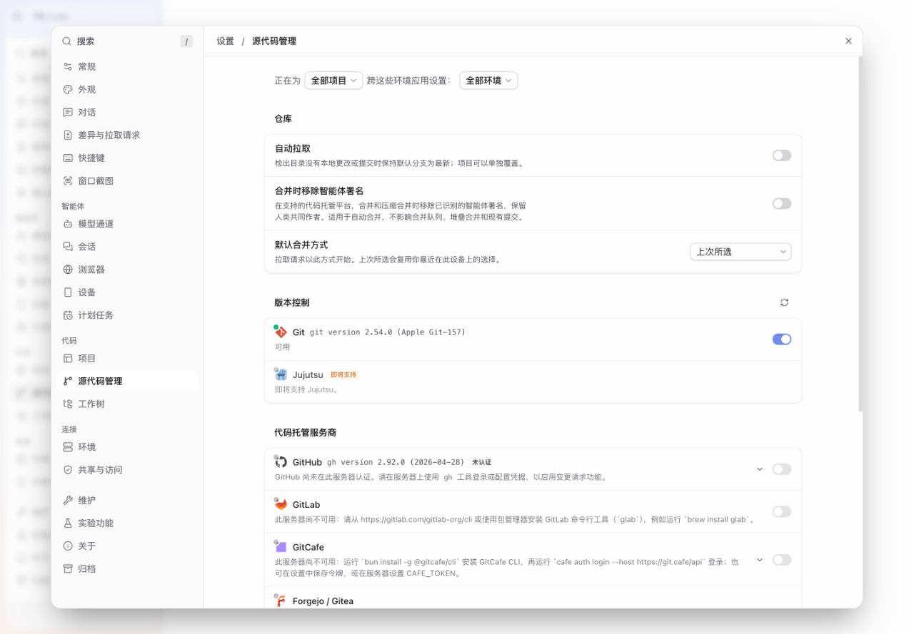
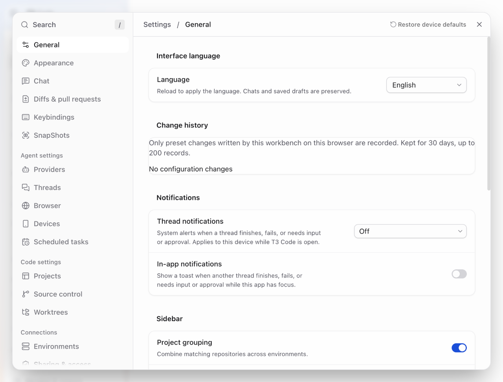

# Xiaoxin T3 Code C30：上游内核更新与中文工作台

[English](RELEASE.en.md) · 2026-10-30 · macOS Apple 芯片（arm64）社区预发布

C30 将已合并的官方主线更新带入 Xiaoxin 桌面构建，同时保留中文设置、侧栏、输入框和图片产物工作流。**C30 是社区构建编号，不是新的官方版本号。** 本次源码以官方 0.1.5 为起点，实际合入其后的 126 个官方提交，冻结目标为 `97e35bcf23e4dcf34c2dcffadd37c08db0e01e52`；社区集成提交为 [`a1edc7703f`](https://github.com/labixiaoxins/xiaoxin-t3code/commit/a1edc7703f8050cedd7b5afc97bba8bef5d5617d)。

源码检查、安装包检查和本机安装后读回是三项不同的验证。最终安装包与安装状态分别见下文，不能仅凭源码已更新判断桌面应用已替换。

## 日常使用中的变化

- **停止任务更完整。** 接入官方 Stop 状态流转与无响应时的 Force stop 入口，保留权限、能力检查及过期 `runId` 保护；同时保留定制的递归子任务停止和用量保护。重启后的续接、停止后重试及待处理队列也包含相关修复。
- **压缩过程有明确状态。** 保留 Claude 明确拒绝压缩时显示失败的行为；修复时间线去重过滤过宽的问题，使“返回会话后压缩”等场景仍显示合法的“正在压缩”状态，而普通执行提示不会重复显示。
- **后台查询和恢复路径更新。** 合入定向恢复读取、后台查询、任务准备、Git 状态探测及大 checkpoint 传输改进。分页文件列表保留总文件数与完整 diff 入口，避免把首批返回的文件当成全部文件。
- **中文设置继续完善。** 保留中文分类、中文搜索和动态说明；补齐新增应用文案，修正模型数量的复数显示及空闲压缩选项的中文。品牌、命令、用户内容、密钥引用及未知外部诊断保持原样。

现有三行输入框、侧栏组织、上下文／用量／磁盘入口、图片修改意见开关、图片对比规则和预览小窗锚点继续保留。官方文件目录栏的改进不会替代定制预览小窗的定位逻辑。

## 数据库、性能与数据保留

- SQLite 使用最多四个惰性 WAL reader worker，事务绑定其取得的 reader；保留 reader 启动失败时的回退逻辑。
- SQL migration 073 只为活跃 turn items 增加两个部分索引，不修改聊天正文或删除历史记录。首次启动建索引仍可能占用时间、空间和写锁。
- `temp_store = MEMORY` 可减少部分磁盘等待，也可能增加大型查询的内存峰值；上游提交中的加速倍数不作为本版的性能保证。
- 对临时 V1 导入副本采用保守清理：只自动清理名称匹配、带已退出 PID 的临时目录；存活 PID 和无 PID 的旧式目录保留。未知所有者的旧副本不会仅因名称或时间较早而自动删除，代价是部分残留需人工核验后清理。

在独立冷备份副本上执行新增索引 SQL 后，完整会话、消息与记录内容的指纹保持一致，数据库 `quick_check` 通过；该测试副本已移除。此项验证没有写入正在使用的聊天数据库。

## 密钥来源支持与安全修复

C30 包含 Secrets 后端契约和环境变量的 `string | SecretReference` 支持。**服务端能力已具备，网页 Secrets 入口的功能开关默认仍为关闭。** 这不等于已配置或启用密码库；本轮没有导入凭据，也没有读取真实 1Password 内容。

同时合入克隆错误 URL 查询凭据隐藏、签名资源路径日志保护、复合及下划线凭据键脱敏、配对权限与验证码处理，以及会话整理工具拒绝未知参数等修复。

## 已完成的源码验证

| 检查 | 结果 |
| --- | --- |
| 相关自动化测试 | 200 个文件通过、1 个平台专用文件跳过；3953 项通过、7 项跳过 |
| React Compiler | 96 项通过；另外 2257 项不在本轮范围 |
| 包类型检查 | 39 个包通过 |
| 格式、lint、两阶段 knip、GraphQL、依赖补丁检查 | 通过 |
| 服务端与网页构建 | 通过 |
| 隔离界面与免费 Replay | 点击停止后界面恢复空闲，后台运行记录进入 `interrupted`；中文导航、搜索和较窄窗口检查通过 |

本轮修复了一处真实的压缩状态过滤问题；相关测试原断言未改，整份时间线测试的 90 项通过。另对 macOS 路径别名和不区分大小写文件系统调整了测试夹具，保留原有行为断言，没有为通过测试倒退生产逻辑。

这些结果不代表全部仓库 CI、原生 Rust、移动端、真实付费模型或真实外部密码库均已验收。Replay 验证不等于真实模型在所有中断条件下的行为验证；性能也需结合最终安装后的有效空闲窗口判断。

## 安装包验证

完整桌面外壳、服务端与网页重新构建；签名、ZIP 完整性与 159 个文件／14 个符号链接逐一核验通过。3069 项文本、map 及原生扩展隐私扫描无发现，终端原生库经打包 Electron 实际加载并成功启动测试 shell。公开分发副本仅移除一个 node-pty 文件的本机构建调试符号，所有 Mach-O section 字节、架构和导出保持不变，其他 95 个原生成员逐字节一致。原本机候选不变。最终包的桌面启动、旧库迁移、原消息显示及中英文切换检查通过。

目标平台为 **macOS Apple 芯片（arm64）**。社区构建采用临时签名，未经 Apple 公证。校验 ZIP 附件时，以发布页提供的 `SHA256SUMS.txt` 和 `release-manifest.json` 为准；不要用源码提交号代替安装包校验值。

## 本机安装后读回

截至本次发布，本机 C30 安装器已启动并处于等待全部任务空闲状态；当前运行的仍为 C29。安装后聊天、登录、设置、SQL073 索引与 CPU 读回尚待安装器完成，不在此预先宣称通过。已验证 C30→C29 在同一合成迁移库上能启动并保留原消息指纹；这是合成数据兼容检查，不代表所有真实负载的回滚验收。

安装回执应区分已暂存、等待任务空闲、已替换和读回通过。CPU 窗口须至少包含 65 个有效样本，中位数 ≤5%、P95 ≤10%；被任务活动或用户输入干扰的窗口不能视为性能失败。一次设备与空闲场景的通过结果也不是所有设备或生成负载下的保证。

## 最终包界面截图

以下为最终 C30 包在隔离合成数据目录中运行的实际截图，已完成目视检查。截图中的未登录状态属于隔离测试环境。

## 升级和恢复

1. 完成正在执行的任务并退出旧版 T3，保留当前应用以及同一时点的聊天、配置和桌面状态备份。
2. 下载适合 Apple 芯片的 ZIP，核对 SHA-256，再替换应用；只运行一份应用，避免不同副本同时管理相同数据。
3. 启动后核对登录、聊天、项目、设置和当前构建。迁移或后台任务尚未完成时，不要据此宣布安装验收通过。
4. 如需回退，先恢复可用的旧应用程序。**不要用旧数据库覆盖升级后新增的聊天。** 涉及数据恢复时，保留数据库、WAL 和 SHM 的完整对应关系，先核对恢复方案。

[C29 发布页与上一版说明](https://github.com/labixiaoxins/xiaoxin-t3code/releases/tag/xiaoxin-c29-20261030) 继续保留，供升级前对照和获取旧安装包。

## 来源、CI 与许可

上游为 [pingdotgg/t3code](https://github.com/pingdotgg/t3code)，保留其 MIT 许可和署名。本次按实际代码合并官方更新并保留社区定制，不以提交计数代替功能或质量验证。现有社区 Actions 工作流继续保留：当前 GitHub 登录缺少修改工作流所需的 `workflow` 权限，本轮没有扩大账号权限。
