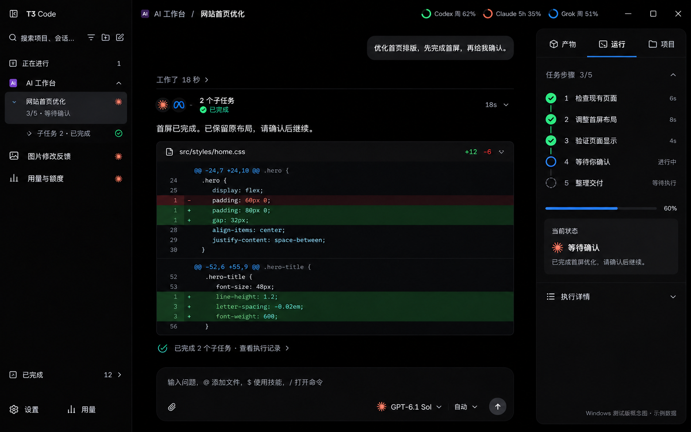
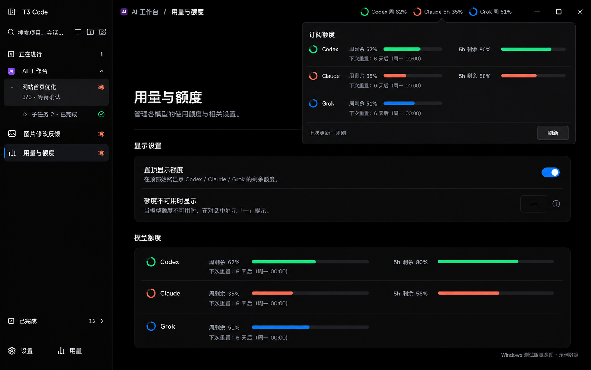
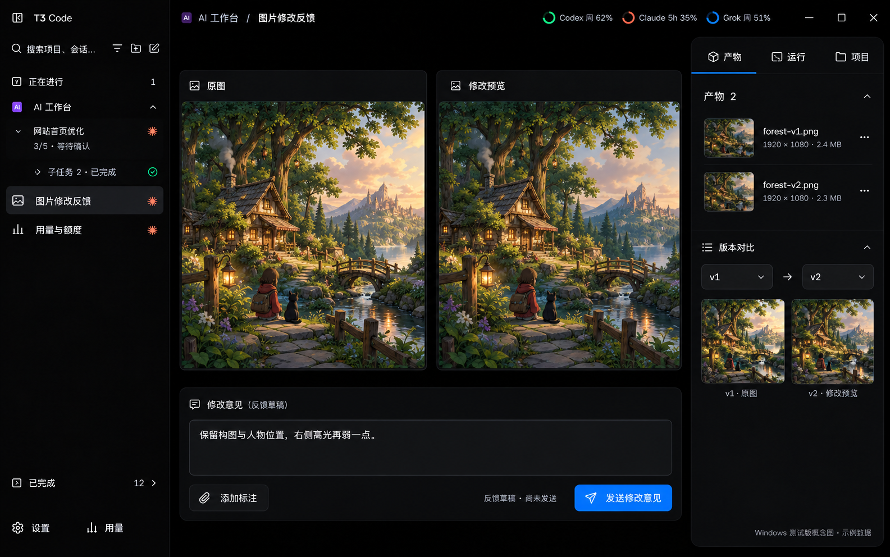

# Windows 测试版 C31-W1

2026-10-31 · Windows 11 / x64 · 社区便携测试版

沿用官方简洁界面，保留定制额度、中文、任务步骤与侧栏进度、产物与图片反馈、字体设置和新会话订阅恢复。去掉 macOS 毛玻璃层，默认使用 Segoe UI / 微软雅黑回退，保留官方 Windows 标题栏按钮、快捷键与缩放。

## 下载与启动

解压到固定目录，双击 `Start-Xiaoxin-T3.cmd`。无需安装 Node。请用此脚本启动，以隔离数据并关闭自动更新。

应用数据与窗口配置：`%LOCALAPPDATA%\XiaoxinT3\C31-W1`；测试端口 43731。不包含 macOS 聊天、登录、密钥或项目。各模型需要 Windows 本机具备可用 CLI 与登录，额度不可用时显示未知状态。

## 三张示意图

以下为设计示意图，数据与任务均为示例，不作为实机验收证据。实际应用保留浅色与深色主题。

## 验证与限制

- 原生底包为官方 v0.1.5 x64；定制桌面、服务端与网页 JavaScript 重新构建。
- 核对保留 31 个 Windows 原生文件及两个 ASAR 中所有已解包原生成员的字节。
- 格式、lint、7 个包类型检查、233 个相关测试和 20 个 React Compiler 检查通过；knip exports 仍报 3 个未使用的回放导出，相关文件本轮无改动。完整检查尚未全绿。
- macOS 专用外盘归档/恢复 worker 和独立刘海工具暂未移植；Windows 归档请求会明确拒绝执行，不清理数据。
- 便携包没有新增 Windows 代码签名。保留官方原生文件不代表定制 JavaScript 获官方背书。

## 回退

退出测试应用后可移走解压目录，独立数据目录会保留。不要覆盖原有官方安装或原有数据目录。
