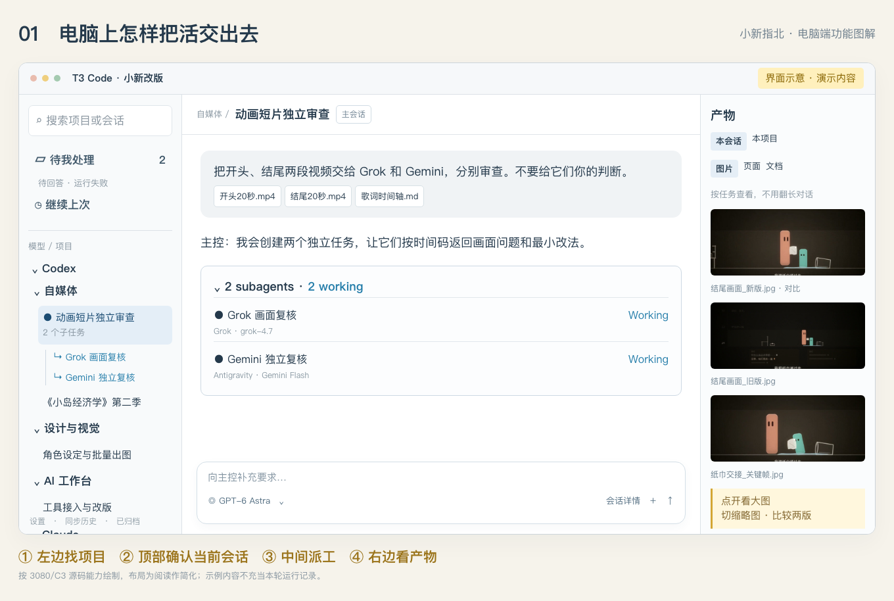
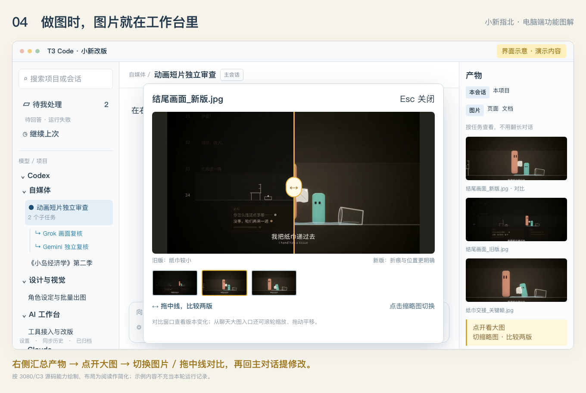

# 小新的 T3 创作工作台：3080/C3

我经常拿 AI 做漫画、动画和图片。任务能交出去以后，还得解决几个实际问题：图在哪儿、助手去哪儿了、哪件事正等着我回答。

这个非官方社区版本基于 [T3 Code](https://github.com/pingdotgg/t3code) 的固定提交 `a01c48f86245f2a779f9af84042f3b09fbdeb91f`，把产物墙、项目分类、待处理和子任务归集放进同一个工作台。本次提交公开对应 3080/C3 本地版本的源码与案例材料，不是官方发行包。发布分支保留既有 fork 的 GitHub Actions 工作流；应用源码以所列 3080/C3 基线为准。



## 先看什么

- [完整案例：Claude 做动画，两个 AI 审片](article.md)
- [X 主推与回复文案](thread.md)
- [官方安装说明](../user/install.md)
- [从源码开发](../internals/overview.md)

## 这版的重点

| 使用时遇到的问题 | 这版怎么处理 | 对应代码 |
|---|---|---|
| 漫画和图片散在长聊天里 | 右侧产物墙按本会话/本项目汇总；图片、页面、文档分开看 | [ArtifactWall.tsx](../../apps/web/src/components/chat/ArtifactWall.tsx)、[服务端产物收集](../../apps/server/src/artifacts/collection.ts) |
| 几个版本看不出改在哪 | 点开大图、切换缩略图，拖中线比较两张图片，还能附回对话继续修改 | [ArtifactWall.tsx](../../apps/web/src/components/chat/ArtifactWall.tsx) |
| 会话多，找不到项目 | 以模型和业务分类组织；分类是展示层，不迁移工作目录 | [workspaceCollections.ts](../../apps/web/src/workspaceCollections.ts)、[LegacySidebar.tsx](../../apps/web/src/components/LegacySidebar.tsx) |
| 助手派出去就散了 | 父子任务归集；可展开结果、查独立子对话，返回主控继续处理 | [sidebarSubtasks.ts](../../apps/web/src/sidebarSubtasks.ts)、[ThreadRelationshipsControl.tsx](../../apps/web/src/components/chat/ThreadRelationshipsControl.tsx) |
| 多个任务在等人回答 | “待我处理”汇总待回答、待授权、运行失败等需关注事项 | [WorkbenchInbox.tsx](../../apps/web/src/components/sidebar/WorkbenchInbox.tsx)、[workbenchInbox.ts](../../apps/web/src/workbenchInbox.ts) |
| 看报告时忘了当前是哪件事 | 顶部项目/会话标题、返回父会话和面板入口与主工作流衔接 | [ChatHeader.tsx](../../apps/web/src/components/chat/ChatHeader.tsx) |

基础标题导航、聊天大图的缩放/拖动、模型接入、跨模型编排和手机连接包含上游能力；本分支在此基础上整合创作工作流。图片查看和版本比较不等于像素编辑，修改内容仍交给 Agent 或编辑工具。



## 获取源码

```bash
git clone --branch community/xiaoxin-creative-workbench-3080 --single-branch \
  https://github.com/labixiaoxins/t3code-artifact-wall.git
cd t3code-artifact-wall
```

本版本的 `package.json` 声明 Node `^24.13.1`、pnpm `11.10.0`。依赖安装和开发启动按仓库开发说明执行，通用入口是 `pnpm install`、`pnpm dev`。没有在读者机器上验证从零安装，不把源码公开写成一键安装包。

需要自行安装或接通相应模型的账号。这个仓库不提供订阅、密钥或本机登录状态。

## 素材与验证

文章中的手机图来自本案例已脱敏的用户截图/录屏，动画图来自实际预览。`09-desktop-real.png` 是隔离验收保存的真实界面，显示虚构测试数据。`10` 至 `13` 是按源码能力绘制的界面示意，均有图内标注，不能当作真实任务成功回执。

本次公开前，194 个定制变更/新增文件与本机来源逐项核对，199 个验收清单中的源码文件哈希一致。该清单对应此前的定向测试、类型和构建记录，本次没有重跑完整测试套件。图文包另外通过本地 xPoster 解析、图片引用和隐私检查；未代表平台发布或用户验收。

不包含本机数据库、聊天历史、账号配置、密钥、签名应用或内部部署回执。完整短片仍以文章所述的预览/返修状态为准。

## 来源与许可

上游：[pingdotgg/t3code](https://github.com/pingdotgg/t3code)。代码保留上游 [MIT License](../../LICENSE)。新增代码沿用该许可。文章和账号插图供阅读、引用及理解案例；不自动授予将账号角色用于商业宣传的许可。
