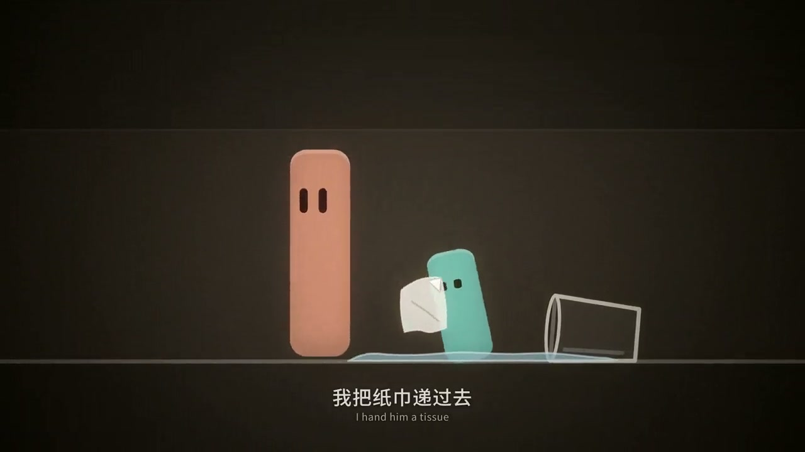
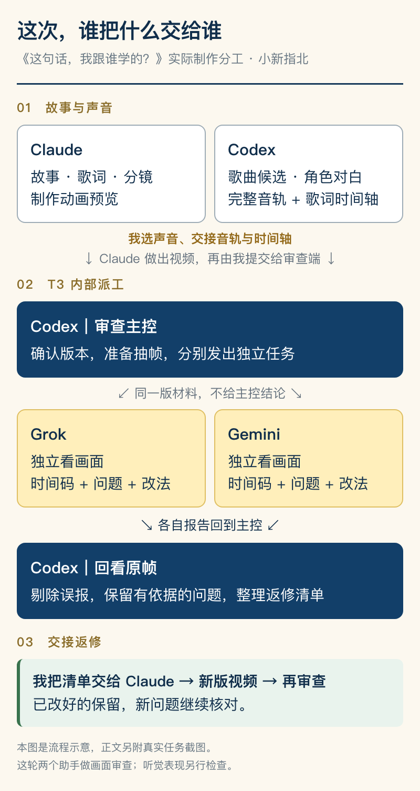
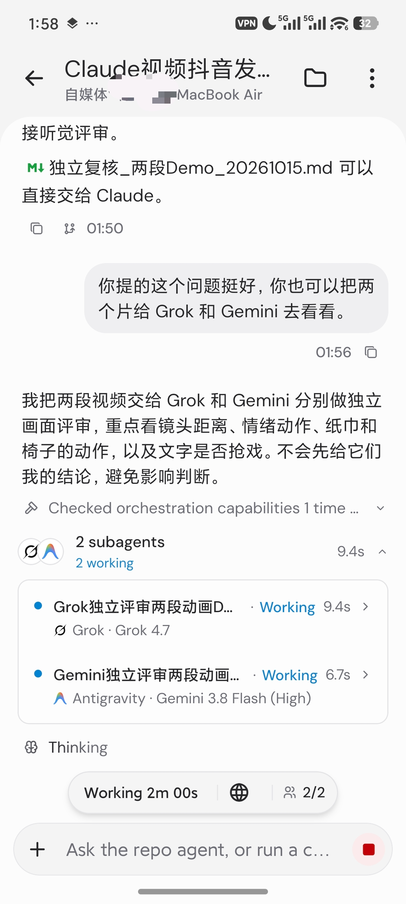
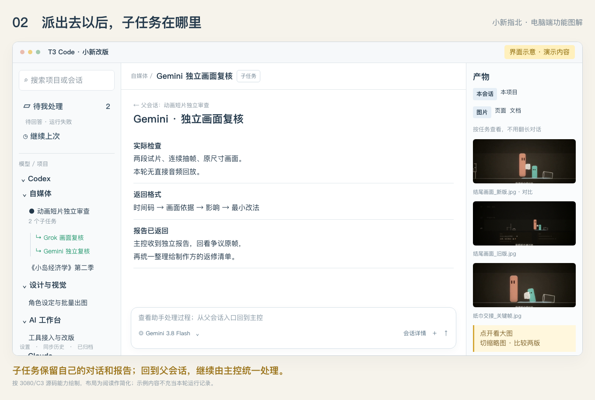
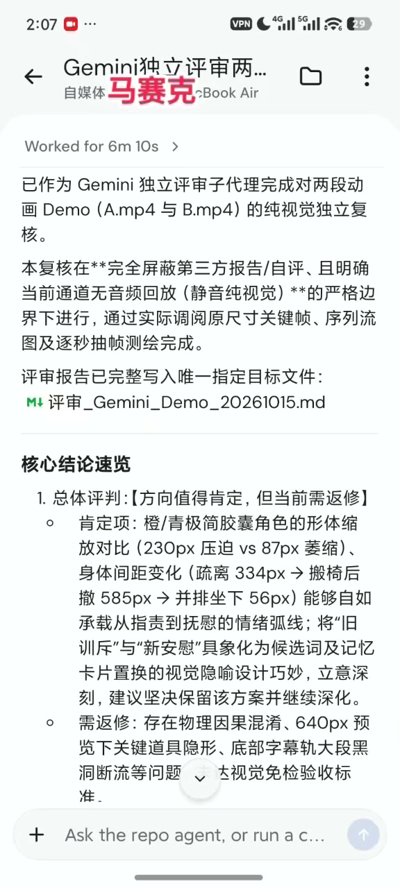
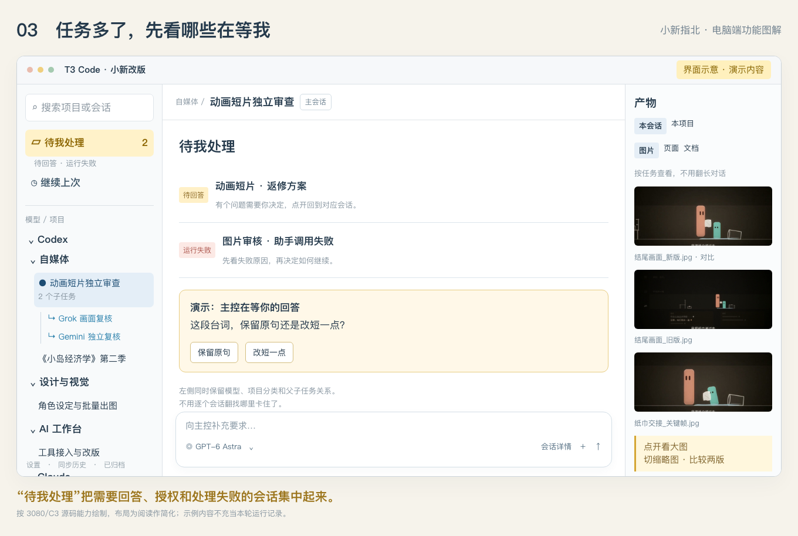
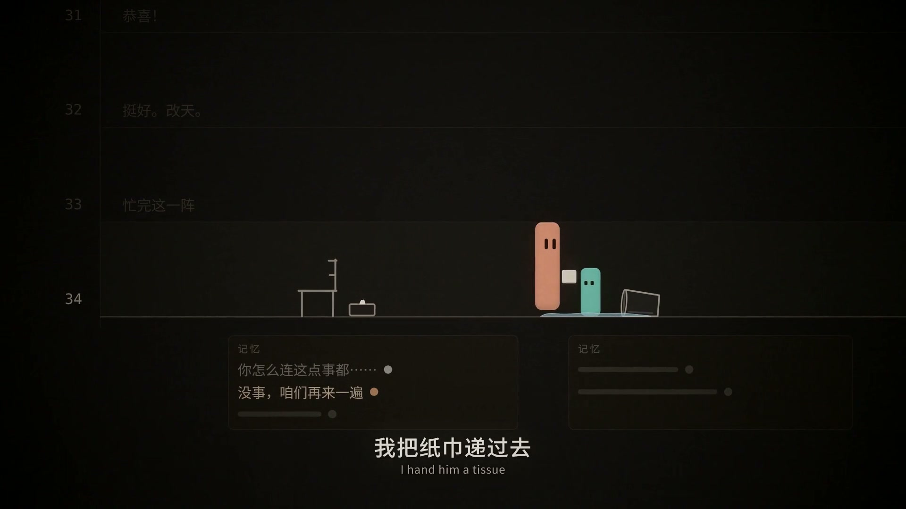
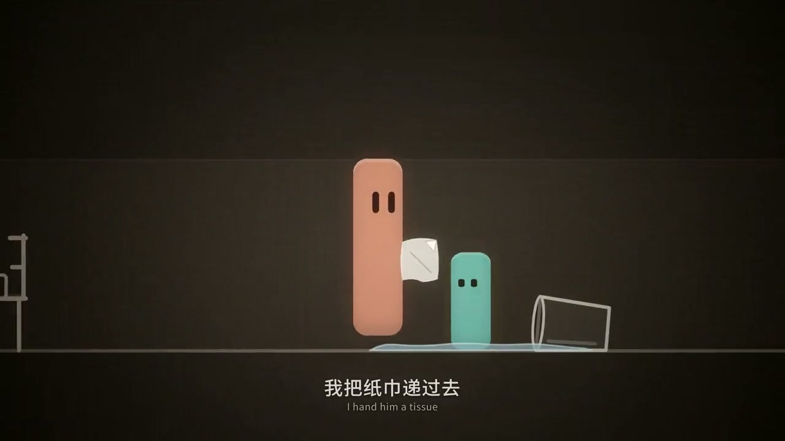
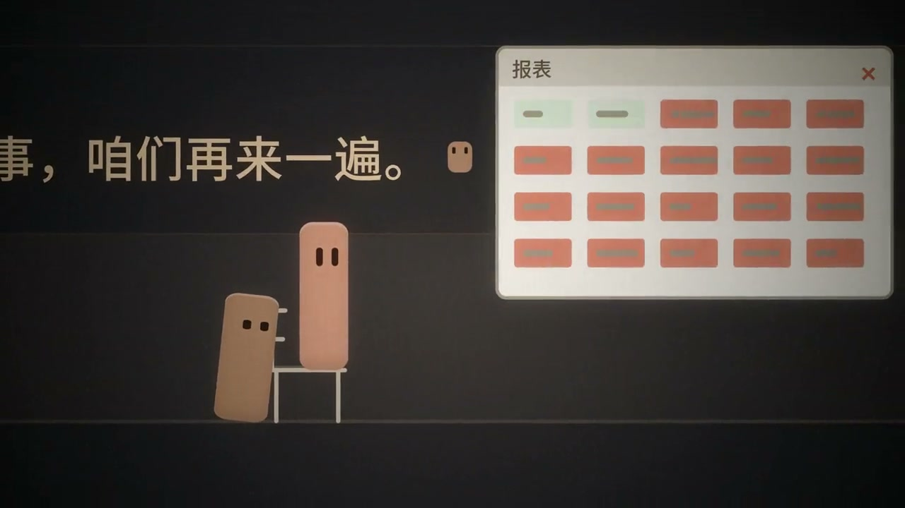

最近我让 Claude 做了一支动画短片，《这句话，我跟谁学的？》。现在已经有 4 分 09 秒的完整预览，还在改。

中间有个挺有意思的过程：Claude 交片以后，我让 Codex 叫来 Grok 和 Gemini，分别检查画面。它们找到了纸巾动作看不清、台词被镜头裁掉的问题，也报过错——说画面漏了一个字，打开原图，那个字明明在。

所以，这篇把整个制作过程拆开讲：**脚本和音乐怎么接上，谁负责派活，两个助手拿到什么，意见怎么回来，以及最后到底改了什么。**

用的工作台是 [T3 Code 官方开源项目](https://github.com/pingdotgg/t3code)。我平时还做漫画和生图，就在它的基础上改了一版：左边整理项目和任务，右边集中看图片，中间继续跟主控沟通。[小新改版源码](https://github.com/labixiaoxins/t3code-artifact-wall/tree/community/xiaoxin-creative-workbench-3080)也一起公开，后面会讲这些界面具体怎么用。



*这是正在返修的动画原帧，纸巾已递到新人一侧。正文里的画面和手机任务卡都来自这次制作。*

## 01｜先把故事和声音做对，再交给动画

故事从一只打翻的水杯开始。

主角正要责备新人，忽然发现，自己快说出口的话，跟小时候父亲责备自己的一模一样。往回想，人生里也有人接住过他：朋友、师父，还有那句“没事，咱们再来一遍”。

结尾回到同一个场景。他把纸巾递过去，拉来一把椅子，换了一句话。

故事的开头和结尾，都在做同一道选择。脚本、音乐、动作都得围着它走，否则很容易做成一串画面好看、情绪却接不上的片段。

这次的分工是：

- **Claude 负责故事、歌词、分镜和动画制作。**
- **Codex 负责声音素材、对白混音、时间轴，以及后面的审查派工。**
- **Grok、Gemini 分别审画面，交独立报告。**
- **我定方向、选声音、决定用哪一版。**

制作和审查分在两个工作区。这次，Claude 与审查端之间的材料仍由我交接；T3 负责审查端内部的派工和结果回传。



*流程示意图，正文另附实际派工截图。*

**音乐这一段，踩过的坑比想象中具体。**

前期用 Suno 做歌曲候选，希望主角念唱，父亲、朋友、师父在各自的位置插一句对白。实际出来，几个角色听着还是像同一个人在说话。

只在歌词里写“这里换成父亲”，没有得到想要的效果。后来把工作拆开：其他角色的对白交给 MiniMax 单独生成，再由 Codex 剪进去。主唱后来换成了我提供、自己认可的本人声音版本。

父亲那句“你怎么连这点事都……”又返修了一次。我听着觉得太温和，甚至怀疑是不是没有放进去。核对音轨后发现，声音确实在，只是表演不对。

于是重做父亲的声线：一个中年人的声音，开口急，句子短，在“都”这里截住。调音量解决不了这个问题。

整理完这些对白，Codex 保留本人声音歌曲的速度，交回**完整音轨和歌词时间轴**。新混进去的对白，还要结合画面听表演和节奏。

时间轴里会写到这种程度：

- 37.06 秒，父亲：“你怎么连这点事都……”
- 65.64 秒，朋友：“跳吧，我接着你！”
- 144.10 秒，师父：“没事，咱们再来一遍。”

Claude 原来的分镜预算约 235 秒，实际选中的歌曲约 249 秒。动画得跟着真实音轨重新排，不能继续按旧表猜“这里应该唱到哪了”。

交给 Claude 的就是这三份文件：剧本、实际使用的音轨、对应的时间轴。做分镜时能直接查到某句话在哪一秒，哪个角色应该开口。

## 02｜先做两段试片，再让两个助手分别看

第一轮送审的是开头、结尾各 20 秒。

这两段刚好能检查故事最关键的变化：开头那句责备有没有停住，结尾的纸巾、椅子和安慰有没有传到新人那里。发现问题时，也能先集中改这几处。

**先看看电脑上的工作台长什么样。** 左侧按模型和业务整理项目、会话；顶部保留项目和当前会话标题；主区处理需求，右侧查看助手或产物。


*这张是本版隔离验收时保存的真实电脑端截图，里面是虚构测试数据，用来展示布局。右侧能展开子任务的完整报告，不是只有一句“完成了”。下文另外用四张标明“界面示意”的图，把入口和去向讲清楚。*

我把两段视频放进 T3 的项目，在 Codex 主对话里说：

> 你也可以把两个片给 Grok 和 Gemini 去看看。

下面就是当时手机上的画面。



*展开 `2 subagents`，能看到两个独立任务、实际模型和 `Working` 状态。这次派工的主控是 Codex。设备名称已遮挡。*

**如果你也要这样做，先做这三步：** 电脑端在 `Settings → Providers` 接通要用的 Agent；把本轮视频和说明放进同一个项目；输入框底部选 Codex，作为这轮主控。先让它检查实际能调用哪些助手，再安排工作。我的 T3 做过本地调整，入口以你安装的版本为准。

不要让主控只转发一句“帮我看看”。下面是按这轮做法整理的指令，可以换成自己的文件；它不是历史聊天逐字记录：

```text
你负责组织本轮审查，先确认 Grok 和 Gemini 可用，
再通过 T3 分别创建真实子任务。

把我选中的两段视频、剧情说明、对应歌词时间轴，
以及你准备的连续抽帧，交给两个助手。
写清楚文件实际位置，确认它们能读到同一版素材。

两边分别判断，不要先给它们你的结论或制作方自评。
重点检查：人物反应、纸巾交接、椅子移动、文字是否抢戏。

每个问题都要给：时间码、画面依据、影响、最小改法。
区分必须修改和可选建议，说明实际检查了哪些材料。
不能听音频就明确写出来，不评价音色和音乐情绪。

只审查，不改源文件。各自返回一份报告。
你收到后回看有争议的原帧，合成一份给 Claude 的返修清单。
```

主控随后通过 T3 的 `delegate_task` 派出任务。两个助手各自读材料、检查画面，在自己的子对话里工作。**它们不会自动知道主对话聊过的全部内容**，所以文件、版本和背景要在派工时带上。


*电脑端界面示意。把文件和要求交给主控后，主区出现助手任务卡；左侧也能沿父会话找到子任务。示例里的文字和状态用于讲解，不是新增的运行回执。*

这一轮实际使用了视频抽帧和连续序列图，两位助手都没有直接听音频。它们的意见适用于画面；音乐好不好听、父亲那句够不够急，还要另外听。

**结果回来，也有地方能看。**


*这时是 `1 working · 1 done`。绿色 `Completed` 下有报告摘要，下方主对话已经收到 Gemini 返回的结果。*

点进具体助手任务，可以继续看它的完整答复，包括它检查了什么、哪里有问题、建议怎么改。主控读取报告后，再把有争议的地方找出来核对。



*子任务保留自己的处理过程。主控收到结果以后继续汇总；想追查细节，就从任务卡、会话详情或左侧子任务入口进去看。*



*从手机录屏提取的原帧，报告写明了“无音频回放”。这是助手的原始意见，其中部分判断后来被主控核对后剔除，下文会讲。*

我在 T3 手机 App 里也能看这些任务状态、展开报告、继续补要求。任务仍由连接的电脑环境执行，手机是跟进和控制入口。

同时跑几个项目，最容易漏掉的是“谁正在等我”。所以左边加了**待我处理**：待回答、待授权、运行失败等需要介入的会话集中在这里。点进去处理完，再回原来的工作。



*电脑端界面示意。这里集中的是需要人介入的事项；助手正常运行时，继续看它自己的任务状态。*

## 03｜审查以后，具体改了什么

先看纸巾。

旧版结尾里，两人之间只有一块很小的白色方块。歌词唱“我把纸巾递过去”，但缩小画面后，很难看懂它从哪里来、递给了谁。



*旧版，按歌曲时间定位到 229.3 秒。*

返修要求被拆成具体动作：纸巾要有折角，抽出来、拿住、伸向新人，新人要有接取或注视反馈。拉椅子也一样，先接触椅背，再让椅子跟着人物移动。

后续完整版里，纸巾变大、有折痕，交接关系也更明确。再往后看，纸巾已经到了新人那一侧。



*后续版，同为歌曲 229.3 秒。两版画质规格不同，这里对照的是道具和动作；动作是否顺畅还要连着看。*

这种意见，制作方拿到就知道该动哪里。“不够感人”“再自然一点”，则很难直接改。

**但两份审查报告，也不能直接拼成返修清单。**

第一轮，Gemini 说“天为什么是蓝的”漏了最后一个字。Codex 回看原尺寸画面，字是完整的，这条被剔除了。它还建议补一层底部字幕，但中央已经在展示同一句安慰，再叠一遍会抢画面。

Grok 说新人没坐下。回看后，角色实际已经到了椅面，问题是落座的动作看起来像上浮。最后留下的要求是“让坐下和放松更容易看懂”，而不是重做一个已经存在的动作。

主控在这里要做取舍：**报告说得再肯定，也得能在原片里找到依据。**

到了完整版，检查重点又变了。纸巾已经改善，就不该把旧批评原样抄回来。

新一轮里发现两个具体问题：一处聊天是朋友问“出来吃饭？”，主角却回“没事，你忙吧”，前后接不上；另一处是师父的安慰台词原本显示完整，镜头往右移以后，左边几个字被裁掉了。



*这项仍待返修。可以让整句停留一拍、淡出后再移镜；也可以把台词放在屏幕安全区。这张是问题证据，尚没有对应修后画面。*

这就是下一轮要交给 Claude 的明确任务：改哪句来信，哪一段镜头需要调整，哪些已经改好的动作保留。

## 04｜我还把它改成了一个能顺手看图的工作台

做漫画和动画，出一张图只是开始。接下来还得看上一版、放大找细节、告诉 AI 哪儿要改。图一多，靠翻聊天找文件，找着找着就忘了自己原来要说什么。

所以我们这版重点补的是这几件事。

**右边专门留了一块地方放图片。** 产物侧栏可以切“本会话”和“本项目”，把图片、文档、页面分开看。漫画一页页出，或者一个角色改了几轮，都能从这里点开，不用先去文件夹猜文件名。选中图片后还能切换缩略图，再把需要的图附回对话，继续提要求。

**看图和比较修改，也能留在主界面。** 聊天里的大图可以缩放、拖动查看；产物对比窗口里，可以拖中线比较两张图，再换下面的缩略图。像这次纸巾的大小和折痕，前后放在一起就很直观。


*界面示意，图里的旧版和新版画面来自这次动画。缩放、平移、切图、对比调整的是查看方式；要改画面内容，选图交回 Agent 继续做。*

**顶部标题栏也一起整理了。** 当前项目、会话标题、返回父会话和面板入口放在你看得见的位置。左边展开一堆项目、右边又开着报告时，抬头就能确认自己现在在哪个任务，不至于把给漫画的要求发进动画审查里。

再加上左边的业务分类、父子任务归集和“待我处理”，这套改动就很符合我自己的工作：一边做内容，一边审稿，一边改图，最后还能找得到前一版。

模型接入、手机连接和基础标题导航沿用官方能力；产物墙、待处理入口、分类与子任务归集等，是这次公开版本重点整理的改动。具体代码和对应位置放在仓库说明里。

- [T3 Code 官方仓库](https://github.com/pingdotgg/t3code)
- [小新改版源码：3080/C3 分支](https://github.com/labixiaoxins/t3code-artifact-wall/tree/community/xiaoxin-creative-workbench-3080)
- [这版改了什么，以及本文图文素材](https://github.com/labixiaoxins/t3code-artifact-wall/blob/community/xiaoxin-creative-workbench-3080/docs/xiaoxin-showcase/README.md)

公开的是源码和配套示例，模型账号需要各自接通。官方安装包与这个定制分支的界面可能不同。

第一次做多助手协作，可以先照着这次的分法来：**制作方先交一个可看的片段，主控把同一版材料交给独立助手，报告回来以后再统一决定怎么改。** 每轮都留好视频版本和修改清单，下一轮才不会拿旧意见改新片。

你卡在派工、素材交接还是改图，可以在评论里讲具体问题。
