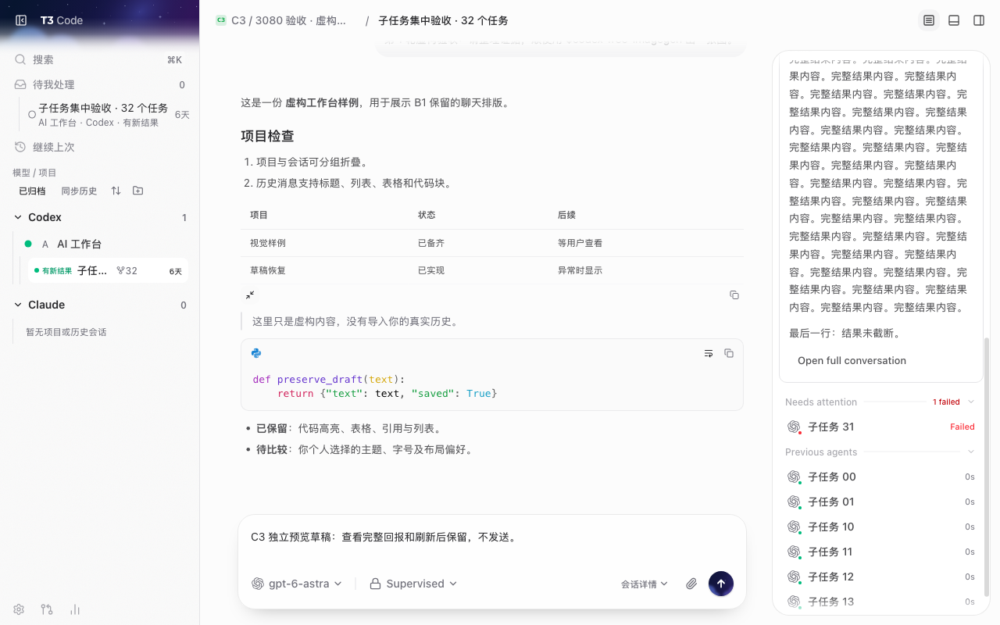
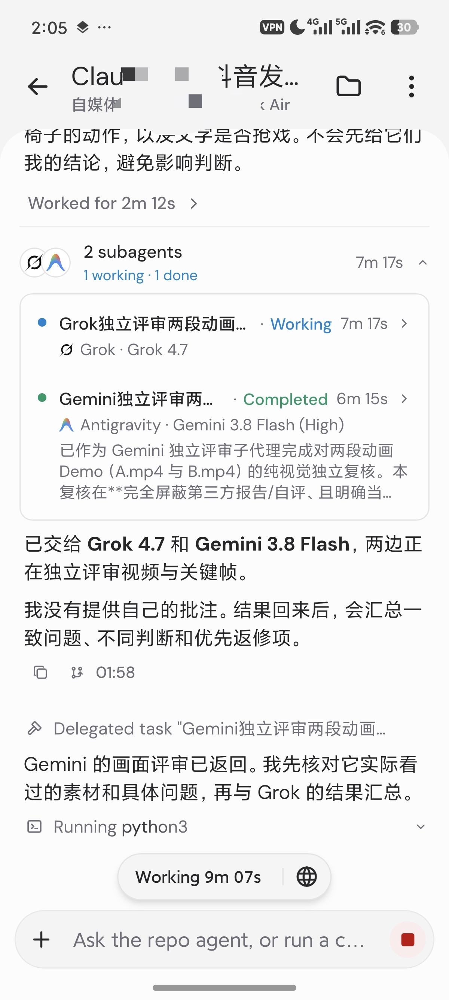

## 主推

Claude 做动画，Codex 派 Grok 和 Gemini 审片。

这支 4 分 09 秒短片，怎么从脚本、配乐走到返修？

把分工、派工指令、电脑端图解和手机实录放在一起讲。还公开了我这版的图片侧栏、拖动对比、项目分类与待处理入口。

目前仍在返修，下面拆实际过程。

## 首评

给主控派活时，我会写清：谁来审、读哪一版、只查什么、交回什么。

可以先用这一段：

分别让 Grok 和 Gemini 审查同一版视频，不给它们你的结论。按时间码、画面依据、影响、最小改法返回；说明实际检查的材料。你回看争议原帧后，整理给制作方的返修清单。

## 次评

长文链接：<发布后替换>

工作台开源地址：https://github.com/pingdotgg/t3code

小新改版源码：https://github.com/labixiaoxins/t3code-artifact-wall/tree/community/xiaoxin-creative-workbench-3080

卡在派工、素材交接还是返修，可以留言讲具体问题。
